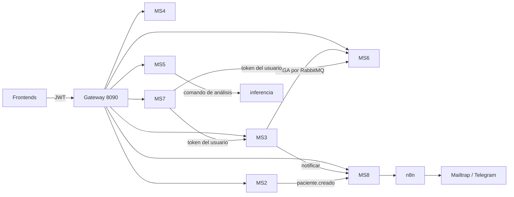

# SIGEC - Sistema Integral de Gestión de Clínicas

Monorepo del curso Ingeniería de Software II (UAGRM): microservicios en varios lenguajes, frontends con microfrontends y una capa de inteligencia (ML, RAG, voz).
Las reglas de arquitectura, convenciones y comandos de prueba están en [`AGENTS.md`](AGENTS.md); el estado por bloque en [`CLAUDE.md`](CLAUDE.md);
los límites conocidos en [`docs/PENDIENTES.md`](docs/PENDIENTES.md).

## Levantar todo con Docker

```bash
cp .env.example .env          # cambia las contraseñas (cada "cambia_esto")
make up-all                   # infraestructura + microservicios + frontends + ML
# o, sin los servicios de ML pesados (TensorFlow, Whisper, embeddings):
make up-core
make ps-all                   # estado
make down-all                 # parar (los datos quedan en volúmenes; -v los borra)
```

`make up-all` equivale a
`docker compose -f docker-compose.yml -f docker-compose.full.yml --profile ml --profile inferencia up -d --build`.
`docker-compose.yml` es solo la infraestructura; `docker-compose.full.yml` le **superpone** los microservicios, los frontends y una tarea `init` que
crea las tablas de DynamoDB, la topología de RabbitMQ, el bucket S3 y la colección de MongoDB (todo repetible).

La primera construcción tarda (Maven, pnpm, Composer, TensorFlow). Los modelos de Whisper (~460 MB) y de embeddings (~470 MB) se descargan en el primer arranque.

Guía completa (crear usuarios, tiempos, operación diaria, problemas conocidos): [`docs/docker.md`](docs/docker.md). Tras la primera vez, `make up-core` basta para volver a levantar todo.

**Una vez arriba**, abre <http://localhost:5173> (shell). Inicia sesión con el **nombre de usuario** (no con el correo). Usuarios de prueba del realm `sigec` (solo para desarrollo):

| Usuario | Contraseña | Rol | Correo |
|---|---|---|---|
| `administrador` | `Sigec123!` | administrador | administrador@sigec.test |
| `medico` | `Sigec123!` | medico | medico@sigec.test |
| `recepcion` | `Sigec123!` | recepcion | recepcion@sigec.test |
| `caja` | `Sigec123!` | caja | caja@sigec.test |
| `paciente` | `Sigec123!` | paciente | paciente@sigec.test |

Para crear más usuarios, mira `docs/docker.md`.

### Dónde entra cada quien (URLs)

| URL | A dónde lleva | Para qué / quién |
|---|---|---|
| <http://localhost:5173> | Shell (login con Keycloak y menú por rol) | **Personal de SIGEC**: `administrador`, `medico`, `recepcion`, `caja` |
| <http://localhost:5173/gestion> | Dashboard de inteligencia (ML, asistente de reportes, alertas, políticas) | `administrador`; se abre dentro del shell |
| <http://localhost:5173/admin/usuarios> | Usuarios y roles | `administrador` |
| <http://localhost:5173/clinica> | Pantallas clínicas (pacientes, agenda, historias, caja, tarifario…) | Según el rol; se abre desde el menú del shell |
| <http://localhost:5174> | PWA del paciente (inicio, citas, solicitar cita, estudios); instalable | **Pacientes**: usuario `paciente` |
| <http://localhost:8080> | Keycloak (consola de administración y login) | Administrar realm, usuarios y roles (`KEYCLOAK_ADMIN` del `.env`) |
| <http://localhost:8080/realms/sigec/account> | Cuenta del usuario en Keycloak | Opcional; no hace falta para usar SIGEC |
| <http://localhost:8090> | Gateway (API, exige token; sin él responde 401) | Lo usan los frontends; no se abre a mano |
| <http://localhost:5175> / <http://localhost:4201> | Remotos Vue (dashboard) y Angular (clínica) | Los carga el shell; no se abren directamente |
| <http://localhost:15672> | Consola de RabbitMQ | Ver colas y eventos (desarrollo) |
| <http://localhost:5678> | n8n | Flujos de notificaciones (correo/Telegram) |

La app móvil (`apps/mobile_flutter`) no tiene URL: corre en un emulador o dispositivo.
Los workflows de n8n se importan con `make n8n-import` (una vez, tras el primer arranque).

> Si el 5432, 27017 o 8000 están ocupados por otros proyectos, define `POSTGRES_HOST_PORT`, `MONGO_HOST_PORT` o `DYNAMODB_HOST_PORT` en `.env`.
> Dentro de la red de Docker los servicios siempre usan los puertos normales.
>
> Lo que **no** está en Docker: la app móvil (Flutter, se ejecuta en un dispositivo/emulador) y la Lambda `lambda-outbox` en AWS (aquí la reemplaza el contenedor `outbox-poller`).
> Sin claves de Gemini/Claude, MS7 usa `LLM_PROVIDER=simulated`; sin Mailtrap/Telegram las notificaciones reales no funcionan (ver `docs/PENDIENTES.md`). **Lo que tienes que hacer tú (claves, bot de Telegram, Kaggle, móvil): [`docs/tu-parte.md`](docs/tu-parte.md).**

## Mapa de servicios y bases de datos

Regla: **una base por servicio, sin claves foráneas entre bases**. Las referencias entre servicios son UUID "blandos" y la consistencia es eventual por eventos (RabbitMQ).
Detalle completo, diagramas ER y patrones de acceso en [`docs/datos/`](docs/datos/README.md).

| Servicio | Puerto | Tecnología | Base de datos | Qué guarda |
|---|---|---|---|---|
| **Gateway** | 8090 | Spring Cloud Gateway | — | Único punto de entrada `/api/**` y `/graphql`; valida JWT y aplica CORS |
| **Keycloak** | 8080 | Keycloak 26 | PostgreSQL `keycloak` | Realm `sigec`, usuarios, roles y claim `paciente_id` |
| **MS2 Pacientes** | 8082 | Spring Boot 4, Java 21 | PostgreSQL `ms2_pacientes` | `pacientes`, `especialidades`, `medicos` (catálogo), `outbox`, `idempotency_keys` |
| **MS3 Citas** | 3003 | NestJS | DynamoDB `citas` (+ `idempotency_keys`, `outbox`, `processed_messages`) | Citas, horarios, estado de la SAGA; reservas atómicas con `TransactWriteItems` |
| **MS4 Historias clínicas** | 8084 | Spring Boot 4, Java 21 | PostgreSQL `ms4_historias` | `historias_clinicas`, `consultas`, `antecedentes`, `evoluciones`, `consentimientos`, `auditoria_accesos`, `outbox` (*solo el esqueleto: aún sin API*) |
| **MS5 Imágenes** | 3005 | NestJS | MongoDB `sigec_imagenes.imagenes` + S3 (SeaweedFS) + DynamoDB `ms5_idempotency_keys` | Metadatos y resultado de IA de cada radiografía; el binario va a S3 |
| **MS5 inferencia** | 8005 | FastAPI + TensorFlow | — (lee S3, habla por RabbitMQ) | Clasifica radiografías (modelo `stub-no-clinico` hasta entrenar) |
| **MS6 Facturación** | 8006 | Laravel (PHP) | PostgreSQL `ms6_facturacion` | `facturas`, `tarifas`, ledger, `outbox`, `idempotency_keys`, `processed_messages` |
| **MS7 Inteligencia** | 3007 | NestJS + GraphQL | PostgreSQL `ms7_inteligencia` (pgvector) | Fragmentos del RAG (índice HNSW) y auditoría del agente |
| MS7 ml / whisper / embeddings | 8007 / 8017 / 8027 | FastAPI | — (modelos en el volumen `ms7_models`) | Inasistencia y K-means / voz a texto / vectores para el RAG |
| **MS8 Notificaciones** | 3008 | NestJS | DynamoDB `notificaciones` (+ `ms8_idempotency_keys`, `ms8_outbox`, `ms8_processed_messages`) | Contactos, notificaciones, reintentos, códigos de vinculación de Telegram |
| **n8n** | 5678 | n8n | PostgreSQL `n8n` | Workflows de correo (Mailtrap) y Telegram |

### Infraestructura

| Pieza | Puerto | Para qué |
|---|---|---|
| PostgreSQL (pgvector pg16) | 5432 | Una base por servicio: `ms2_pacientes`, `ms4_historias`, `ms6_facturacion` (+ `_test`), `ms7_inteligencia`, `keycloak`, `n8n` (`infra/postgres/init.sql`) |
| MongoDB 7 | 27017 | Metadatos de imágenes de MS5 (con validador `$jsonSchema`, `scripts/mongo-init`) |
| DynamoDB Local | 8000 | Citas (MS3), notificaciones (MS8) e idempotencia (`scripts/dynamodb-init.mjs`) |
| SeaweedFS (S3) | 9000 | Bucket privado `radiografias` |
| RabbitMQ | 5672 / 15672 | Eventos y comandos; topología en `contracts/events/topology.json` |
| `outbox-poller` | — | Publica el outbox de DynamoDB (MS3/MS8) en RabbitMQ (en AWS: Lambda) |

### Frontends

| App | Puerto | Tecnología | Función |
|---|---|---|---|
| `apps/shell` | 5173 | React + Rsbuild (Module Federation) | Contenedor: login con Keycloak (PKCE) y carga de los remotos |
| `apps/remote-vue` | 5175 | Vue + Vite | Remoto: dashboard de inteligencia (GraphQL, gráficos, voz) |
| `apps/remote-angular` | 4201 | Angular (Module Federation 2 con Vite) | Remoto Angular (esqueleto) |
| `apps/pwa-paciente` | 5174 | React + Vite PWA | Portal del paciente, instalable (sin lógica offline de datos aún) |
| `apps/mobile_flutter` | — | Flutter (Riverpod + go_router) | App móvil del paciente (se ejecuta en dispositivo/emulador) |

## Cómo se comunican



- **Identidad:** no existe un MS1; cada servicio valida el JWT de Keycloak (rol en `realm_access.roles`).
- **Mensajería fiable:** *outbox* (misma transacción que el cambio de negocio), publicación con confirms, consumidores con reintentos y DLQ, deduplicación por `id`. Ver `docs/outbox.md`, `docs/idempotencia.md`, `docs/saga-citas.md`.
- **Escrituras:** `Idempotency-Key` obligatoria en POST/PUT/PATCH de negocio.

## Desarrollo sin contenedores para los servicios

Para iterar con recarga en caliente, deja solo la infraestructura en Docker y ejecuta los servicios en el host:

```bash
docker compose up -d                       # solo infraestructura (docker-compose.yml)
make dynamodb-init rabbitmq-declare s3-init mongo-init
scripts/dev-services.sh start              # gateway, ms2..ms8, ML (necesita Java 21, Node, PHP)
scripts/dev-services.sh status
```

No mezcles ambos modos a la vez: usan los mismos puertos.

## Comandos útiles

| Qué | Comando |
|---|---|
| Datos de ejemplo coherentes entre servicios | `make seed` / `make seed-reset` |
| Regenerar diccionario y ERD desde las bases reales | `make datos-docs` |
| Importar workflows de n8n | `make n8n-import` |
| Reprocesar una DLQ | `make dlq-replay QUEUE=<cola>` |
| E2E de la SAGA / MS7 / imágenes / notificaciones | `make e2e-saga`, `scripts/e2e-ms7.sh`, `scripts/e2e-imagenes.sh`, `scripts/e2e-notificaciones.sh` |
| Pruebas por servicio | ver la tabla "Pruebas" de [`AGENTS.md`](AGENTS.md) |

## Estructura del repositorio

```
apps/          shell, remotos Vue/Angular, PWA, móvil
services/      gateway, ms2..ms8 (cada uno con src/{domain,application,infrastructure})
packages/      auth-nest, messaging-nest, idempotency-nest, mfe-contract, api-types
contracts/     JSON Schema de eventos, topología de RabbitMQ, contrato de idempotencia y de microfrontends
infra/         init de PostgreSQL, realm de Keycloak, workflows de n8n, Dockerfiles compartidos (infra/docker)
ml/            entrenamiento de modelos (neumonía, inasistencia, demanda)
scripts/       inicialización de datos, semilla, E2E, utilidades
docs/          arquitectura por tema; docs/datos = modelo de datos
```
