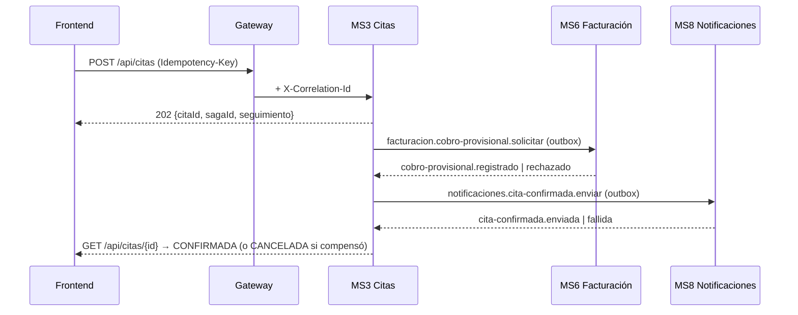

# API de SIGEC: convenciones, rutas y flujos

Todo el tráfico de los frontends entra por el **gateway** (`http://localhost:8090`, solo `/api/**` y `/graphql`). Cada servicio vuelve a validar el JWT de Keycloak.
Los contratos REST versionados están en `contracts/openapi/<servicio>.json` y los tipos TypeScript en `packages/api-types` (ver «Contratos»).
Los mensajes asíncronos están en `contracts/events/` (ver `contracts/events/README.md`).

## Convenciones (iguales en todos los servicios)

| Tema | Regla |
|---|---|
| Errores | `application/problem+json` (RFC 7807): `{type, title, status, detail, code, errors?, instance, correlationId}`. El `code` es estable (`HORARIO_OCUPADO`, `PACIENTE_DUPLICADO`, `COBRO_VIGENTE_EXISTENTE`, `CURSOR_INVALIDO`…); sin `code` propio se usa el del estado (`NO_AUTENTICADO` 401, `PROHIBIDO` 403, `NO_ENCONTRADO` 404, `CONFLICTO` 409, `REGLA_DE_NEGOCIO` 422, `ERROR_INTERNO` 500). |
| Validación | `400` con `code: "VALIDACION"` y `errors: [{campo, mensaje}]`. Una regla de negocio incumplida es `422` (y `409` si es conflicto de estado). |
| Listas | `?limite&cursor` (por defecto 25, máximo 100) → `{items: [...], siguiente: "<cursor>"\|null}`. El cursor es opaco; uno manipulado da `400 CURSOR_INVALIDO`. |
| Campos | camelCase en HTTP y en eventos. Fechas ISO-8601 UTC. Dinero como string decimal (`"180.00"`) junto a `moneda` (`"BOB"`). |
| Estados | `201` crea de forma síncrona (con `Location`); `202` inicia una SAGA (se consulta después); `409` conflicto; `404` también para un recurso ajeno de un paciente (no se revela su existencia). |
| Correlación | `X-Correlation-Id`: lo crea el gateway si falta, lo reenvían los servicios y aparece en la respuesta y en `correlationId` de todo error. |
| Idempotencia | `Idempotency-Key` (UUID) obligatoria en POST/PUT/PATCH de negocio (`contracts/idempotency.md`). Errores propios: `IDEMPOTENCY_KEY_INVALIDA` 400, `IDEMPOTENCY_KEY_REUTILIZADA` 422, `PETICION_EN_PROCESO` 409. |
| Concurrencia | Ediciones con `If-Match: <version>`; si otro profesional cambió el registro, `409 VERSION_CONFLICTO` con la versión vigente. |
| CORS | Solo en el gateway. Permite `Authorization, Content-Type, Idempotency-Key, If-Match, X-Correlation-Id, Accept-Language`; expone `Idempotent-Replay, Retry-After, Location, ETag, X-Correlation-Id`. |

Implementación: Nest `@sigec/http-nest` (`aplicarConvenciones(app)`), Spring `ProblemaBase` + `CorrelationFilter` (MS2/MS4), Laravel `App\Support\Problem` + middleware `Correlation` (MS6), gateway `web/CorrelationFilter` + `ProblemJsonSecurityHandlers`.

## Rutas del gateway

| Prefijo | Servicio | Estado |
|---|---|---|
| `/api/pacientes/**`, `/api/especialidades/**`, `/api/medicos/**` | MS2 Pacientes (`:8082`) | hecho (Fase 1) |
| `/api/historias/**` | MS4 Historias clínicas (`:8084`) | hecho (Fase 4) |
| `/api/citas/**` | MS3 Citas (`:3003`) | hecho (Fase 2) |
| `/api/imagenes/**` | MS5 Imágenes (`:3005`) | hecho (Fase 5) |
| `/api/facturacion/**` | MS6 Facturación (`:8006`) | hecho (Fase 3) |
| `/api/notificaciones/**` | MS8 Notificaciones (`:3008`) | hecho (Fase 6) |
| `/api/inteligencia/**`, `/graphql` | MS7 Inteligencia (`:3007`) | hecho (Fase 7) |
| `/api/identidad/**`, `/api/salud/**` | `ms1-identidad` (`:3001`) | nuevo (Fase 8); el gateway ya lo enruta |

Las rutas `/internal/**` de MS8 y los `/health` de cada servicio **no** pasan por el gateway.

## Endpoints vigentes por servicio

> La lista completa y los esquemas están en `contracts/openapi/`. Aquí solo el mapa.

**MS2** · Pacientes: `POST /api/pacientes` · `GET /api/pacientes?q&tipo=nombre|documento|historia&limite&cursor` (búsqueda fonética: «Rohas» encuentra «Rojas») · `GET /api/pacientes/me` · `GET /api/pacientes/{id}` (+`ETag`) · `PUT /api/pacientes/{id}` (con `If-Match`; evento `paciente.actualizado`). Contactos de emergencia: `GET|POST /api/pacientes/{id}/contactos`, `DELETE …/{contactoId}`. Solicitudes de actualización de contacto: `POST /api/pacientes/{id}/solicitudes` (paciente), `GET /api/pacientes/{id}/solicitudes`, `GET /api/pacientes/solicitudes?estado` (recepción), `POST /api/pacientes/solicitudes/{id}/aprobar|rechazar`. Catálogo: `GET|POST /api/especialidades`, `PUT /api/especialidades/{id}`, `GET /api/medicos?especialidad`, `GET /api/medicos/me|{id}`, `POST|PUT /api/medicos` (administrador; eventos `medico.creado|actualizado`). Lectura del catálogo: cualquier usuario autenticado (resumen sin documento ni contacto).
**MS3** · Citas: `POST /api/citas` (202, SAGA) · `GET /api/citas?pacienteId|medicoId&desde&hasta&estado&limite&cursor` · `GET /api/citas/{id}` · `GET /api/citas/{id}/historial` (estados, pasos de la SAGA y compensación) · `POST /api/citas/{id}/cancelar|reprogramar|asistencia` (200; la reprogramación y la cancelación son atómicas, ver `docs/saga-citas.md`) · `GET /api/citas/disponibilidad` · `GET /api/citas/resumen?desde&hasta&agruparPor=especialidad|medico|estado|mes`. Agenda: `GET /api/citas/agenda?fecha&especialidad&consultorio` (una columna por médico) y `GET /api/citas/agenda/medico/me?fecha`. Horarios: `GET|PUT /api/citas/medicos/{id}/horario` (plantilla semanal), `POST …/horario/generar`, `GET|POST …/bloqueos`, `DELETE …/bloqueos/{bloqueoId}`. Códigos de error propios: `HORARIO_OCUPADO`, `CITA_EN_PROCESO`, `CITA_YA_CANCELADA`, `CITA_NO_MODIFICABLE`, `CITA_PASADA`, `FECHA_PASADA`, `MISMO_HORARIO`, `ASISTENCIA_INVALIDA`, `CITA_FUTURA`, `PLANTILLA_VACIA`.
**MS4** · Historias: `GET /api/historias/paciente/{pacienteId}` · `GET /api/historias/{id}` · `GET|POST /api/historias/{id}/consultas` (`?estado&limite&cursor`; `citaId` opcional, debe estar confirmada o con el paciente en sala) · `GET|PUT /api/historias/consultas/{id}` (+`ETag`; `PUT` con `If-Match`, solo borradores) · `POST …/consultas/{id}/firmar` (solo el médico autor; publica `consulta.firmada`) · `GET|POST …/consultas/{id}/evoluciones` · `GET …/consultas/{id}/receta` (solo firmadas) · `GET|POST /api/historias/{id}/antecedentes`, `PUT|DELETE …/antecedentes/{id}` (`If-Match`; DELETE es baja lógica) · `GET|POST /api/historias/paciente/{pacienteId}/consentimientos`, `POST …/consentimientos/{id}/revocar` (los hace el paciente) · `GET /api/historias/{id}/estudios` (estudios con informe validado en MS5; el paciente no ve los descartados) · `GET /api/historias/{id}/auditoria?tipo=LEER|CREAR|MODIFICAR|EXPORTAR&limite&cursor` (administrador). Roles: `medico` lee y escribe, `paciente` solo lo suyo y firmado, `administrador` solo la auditoría, `recepcion`/`caja` sin acceso; todo acceso queda auditado. Códigos propios: `HISTORIA_NO_ENCONTRADA`, `CONSULTA_NO_ENCONTRADA`, `CITA_NO_HABILITADA`, `CITA_NO_CORRESPONDE`, `CITA_DE_OTRO_MEDICO`, `CONSULTA_YA_EXISTE`, `CONSULTA_FIRMADA`, `CONSULTA_NO_FIRMADA`, `DIAGNOSTICO_REQUERIDO`, `SOLO_AUTOR_FIRMA`, `MEDICO_NO_VINCULADO`, `CONSENTIMIENTO_VIGENTE`, `IF_MATCH_REQUERIDO`.
**MS5** · Imágenes y estudios: `POST /api/imagenes` (multipart `archivo`, `pacienteId` obligatorio para el personal, `estudio`, `observaciones`; el paciente sube a su nombre con `origen=PACIENTE`; `409 IMAGEN_DUPLICADA` si ya se subió esa radiografía para el paciente) · `GET /api/imagenes?pacienteId&validacion=PENDIENTE|VALIDADO|DESCARTADO&estado=<análisis>&q&limite&cursor` (el personal puede listar sin `pacienteId`: bandeja de validación; `q` busca por nombre, n.° de historia o estudio; el paciente solo ve lo suyo ya validado) · `GET /api/imagenes/{id}` · `GET …/{id}/url` · `GET …/{id}/gradcam-url` (`404 GRADCAM_NO_DISPONIBLE` si la inferencia no generó mapa de calor) · `POST …/{id}/validacion {decision: CONFIRMA|MODIFICA|DESCARTA, informe}` (médico; solo sobre estudios analizados y pendientes; firma con huella y publica `imagen.informe-validado`). Códigos propios: `IMAGEN_DUPLICADA`, `ANALISIS_PENDIENTE`, `YA_VALIDADO`, `INFORME_REQUERIDO`, `GRADCAM_NO_DISPONIBLE`.
**MS6** · Facturación y caja: `GET /api/facturacion/facturas?estado&porCobrar&desde&hasta&q&citaId&limite&cursor` (con `numeroCargo`, `pacienteNombre`, `especialidad`) · `POST …/facturas` · `GET …/facturas/{id}` (con pago y ledger) · `POST …/facturas/{id}/pagos` (efectivo con `recibido`, transferencia/POS con `referencia`; publica `pago.registrado`) · `POST …/facturas/{id}/anular` (motivo; no se borra; publica `factura.anulada`) · `GET …/facturas/{id}/comprobante` (JSON o `?formato=html`; **no** es factura fiscal) · `GET …/movimientos?fecha&turno&metodo&tipo` y `GET …/balance?fecha&turno` (dia y turno en hora local de la clinica) · `GET|POST …/tarifas`, `PUT …/tarifas/{id}` (solo las programadas; una tarifa nueva cierra la anterior y no cambia los cargos ya emitidos) · `GET …/facturas/ingresos?desde&hasta&agrupar=dia|mes|especialidad`. Códigos propios: `FACTURA_YA_PAGADA`, `FACTURA_ANULADA`, `FACTURA_YA_ANULADA`, `MONTO_INSUFICIENTE`, `COMPROBANTE_NO_ENCONTRADO`, `VIGENCIA_PASADA`, `TARIFA_DUPLICADA`, `TARIFA_NO_EDITABLE`.
**MS7** · Inteligencia: `POST /api/inteligencia/agente/consulta|voz` · `POST /api/inteligencia/reportes?formato=` · `GET /api/inteligencia/agente/auditoria` · `/api/inteligencia/rag/*` · `POST /graphql` · **alertas y agentes** (administrador y recepción; configurar y ejecutar, solo administrador): `GET /api/inteligencia/alertas?estado&nivel&agente&limite&cursor`, `GET …/alertas/{id}`, `POST …/alertas/{id}/atender {nota}` (`409 ALERTA_YA_ATENDIDA`), `GET …/agentes`, `PUT …/agentes/{id} {activo, intervaloMin 5-1440, umbral}`, `POST …/agentes/{id}/ejecutar`; agentes: `cancelaciones` (tasa de cancelación en 7 días), `inasistencias` (citas de los próximos 3 días con riesgo alto), `demanda` (especialidades sobre el promedio), `ingresos` (caída frente a los 7 días previos); una sola alerta abierta por clave (si persiste se refresca) y aviso al personal por el webhook `alerta-interna` de n8n · `GET …/ml/modelo` (versión, métricas, importancia de variables). Códigos propios: `ALERTA_NO_ENCONTRADA`, `ALERTA_YA_ATENDIDA`, `AGENTE_INVALIDO`. El resumen de citas de GraphQL/MCP lo calcula ahora MS3 (`/api/citas/resumen`); `ingresos` acepta `agrupar=especialidad` en MS6.
**MS8** · Notificaciones: `GET /api/notificaciones?pacienteId&estado&tipo&canal&desde&limite&cursor` (historial, más recientes primero; el personal indica `pacienteId` o `citaId`, el paciente ve solo las suyas; ahora devuelve `{items, siguiente}`) · `GET …/resumen?fecha` (KPIs del día en hora de la clínica) · `PATCH …/{id}/leida` y `POST …/leidas {ids}` (paciente) · `POST …/{id}/reenviar` (solo FALLIDAS; no vuelve a responder a la SAGA) · plantillas: `GET …/plantillas`, `GET …/plantillas/{tipo}?canal`, `PUT …/plantillas/{tipo}` (`If-Match` = versión que se edita, 0 = de fábrica; solo administrador; variables `{{nombre}} {{fecha}} {{hora}} {{cuando}}`; rechaza contenido clínico) y `POST …/plantillas/{tipo}/vista-previa` · preferencias del paciente: `GET|PUT …/preferencias/{pacienteId}` (`canales`, `tiposAviso`, `antelacionHoras` 2/6/12/24/48) · personal: `GET|PUT …/preferencias/personal/me` (alertas internas) · Telegram: `POST …/telegram/vinculo`, `DELETE …/telegram/vinculo[?pacienteId]`. Tipos: `CITA_CONFIRMADA`, `CITA_CANCELADA`, `CITA_REPROGRAMADA`, `RECORDATORIO`, `RECORDATORIO_REFUERZO`, `ESTUDIO_VALIDADO`. Códigos propios: `NOTIFICACION_NO_ENCONTRADA`, `NOTIFICACION_NO_REENVIABLE`, `PLANTILLA_VARIABLE_INVALIDA`, `PLANTILLA_CONTENIDO_CLINICO`, `PLANTILLA_SIN_FECHA`, `PLANTILLA_INVALIDA`, `TIPO_INVALIDO`, `TELEGRAM_NO_VINCULADO`, `FECHA_INVALIDA`. Interno (no pasa por el gateway, con secreto): `POST /internal/recordatorios/{citaId}/reforzar` (un recordatorio extra, p. ej. desde MS7).

Roles de Keycloak: `administrador`, `medico`, `recepcion`, `caja`, `paciente`.

## Flujo vigente: reserva de cita (SAGA)

Detalle de estados, tiempos y compensaciones: `docs/saga-citas.md`.

## Contratos

- **REST:** `contracts/openapi/<servicio>.json`. Nest y Spring lo generan desde el código; MS6 (Laravel) está escrito a mano y un test compara sus rutas con las del código. Los servicios FastAPI (ML, embeddings, Whisper, inferencia) exponen su `/openapi.json` en ejecución y **no** están versionados (internos, no pasan por el gateway).
- **Verificar deriva:** `make openapi-check` (falla si un servicio se desvió o si `api-types` está desactualizado). **Regenerar:** `make openapi-update` y revisar el diff: un cambio de contrato es un cambio de API.
- **Tipos para los frontends:** `packages/api-types/src/<servicio>.d.ts` (generados con `openapi-typescript`); aún sin consumidores.
- **Eventos:** `contracts/events/*.schema.json` + `topology.json` (`contracts/events/README.md`).

## Pendiente (ver el plan del backend en `docs/PENDIENTES.md`)

Fases 1 a 9: catálogo y edición de pacientes, cancelar/reprogramar/horarios/asistencia, pagos y caja, API de historias clínicas, validación de estudios, historial/plantillas/preferencias, alertas de MS7, `ms1-identidad` y los E2E de flujos.
