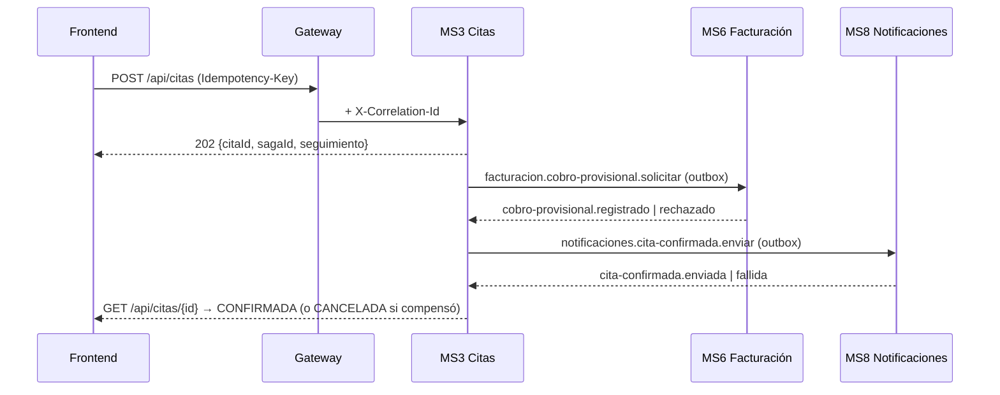

# API de SIGEC: convenciones, rutas y flujos

Todo el tráfico de los frontends entra por el **gateway** (`http://localhost:8090`, solo `/api/**` y `/graphql`). Cada servicio vuelve a validar el JWT de Keycloak.
Los contratos REST versionados están en `contracts/openapi/<servicio>.json` y los tipos TypeScript en `packages/api-types` (ver «Contratos»).
Los mensajes asíncronos están en `contracts/events/` (ver `contracts/events/README.md`).

## Convenciones (iguales en todos los servicios)

| Tema | Regla |
|---|---|
| Errores | `application/problem+json` (RFC 7807): `{type, title, status, detail, code, errors?, instance, correlationId}`. El `code` es estable (`HORARIO_OCUPADO`, `PACIENTE_DUPLICADO`, `COBRO_VIGENTE_EXISTENTE`, `CURSOR_INVALIDO`…); sin `code` propio se usa el del estado (`NO_AUTENTICADO` 401, `PROHIBIDO` 403, `NO_ENCONTRADO` 404, `CONFLICTO` 409, `REGLA_DE_NEGOCIO` 422, `ERROR_INTERNO` 500). |
| Validación | `400` con `code: "VALIDACION"` y `errors: [{campo, mensaje}]`. Una regla de negocio incumplida es `422` (y `409` si es conflicto de estado). |
| Listas | `?limite&cursor` (por defecto 25, máximo 100) → `{items: [...], siguiente: "<cursor>"\|null}`. El cursor es opaco; uno manipulado da `400 CURSOR_INVALIDO`. |
| Campos | camelCase en HTTP y en eventos. Fechas ISO-8601 UTC. Dinero como string decimal (`"180.00"`) junto a `moneda` (`"BOB"`). |
| Estados | `201` crea de forma síncrona (con `Location`); `202` inicia una SAGA (se consulta después); `409` conflicto; `404` también para un recurso ajeno de un paciente (no se revela su existencia). |
| Correlación | `X-Correlation-Id`: lo crea el gateway si falta, lo reenvían los servicios y aparece en la respuesta y en `correlationId` de todo error. |
| Idempotencia | `Idempotency-Key` (UUID) obligatoria en POST/PUT/PATCH de negocio (`contracts/idempotency.md`). Errores propios: `IDEMPOTENCY_KEY_INVALIDA` 400, `IDEMPOTENCY_KEY_REUTILIZADA` 422, `PETICION_EN_PROCESO` 409. |
| Concurrencia | Ediciones con `If-Match: <version>`; si otro profesional cambió el registro, `409 VERSION_CONFLICTO` con la versión vigente. |
| CORS | Solo en el gateway. Permite `Authorization, Content-Type, Idempotency-Key, If-Match, X-Correlation-Id, Accept-Language`; expone `Idempotent-Replay, Retry-After, Location, ETag, X-Correlation-Id`. |

Implementación: Nest `@sigec/http-nest` (`aplicarConvenciones(app)`), Spring `ProblemaBase` + `CorrelationFilter` (MS2/MS4), Laravel `App\Support\Problem` + middleware `Correlation` (MS6), gateway `web/CorrelationFilter` + `ProblemJsonSecurityHandlers`.

## Rutas del gateway

| Prefijo | Servicio | Estado |
|---|---|---|
| `/api/pacientes/**`, `/api/especialidades/**`, `/api/medicos/**` | MS2 Pacientes (`:8082`) | hecho (Fase 1) |
| `/api/historias/**` | MS4 Historias clínicas (`:8084`) | solo esqueleto (Fase 4) |
| `/api/citas/**` | MS3 Citas (`:3003`) | hecho (cancelar, reprogramar, horarios en la Fase 2) |
| `/api/imagenes/**` | MS5 Imágenes (`:3005`) | hecho (estudios y validación en la Fase 5) |
| `/api/facturacion/**` | MS6 Facturación (`:8006`) | hecho (pagos, anulación, caja, tarifas en la Fase 3) |
| `/api/notificaciones/**` | MS8 Notificaciones (`:3008`) | hecho (historial, plantillas, preferencias en la Fase 6) |
| `/api/inteligencia/**`, `/graphql` | MS7 Inteligencia (`:3007`) | hecho (alertas en la Fase 7) |
| `/api/identidad/**`, `/api/salud/**` | `ms1-identidad` (`:3001`) | nuevo (Fase 8); el gateway ya lo enruta |

Las rutas `/internal/**` de MS8 y los `/health` de cada servicio **no** pasan por el gateway.

## Endpoints vigentes por servicio

> La lista completa y los esquemas están en `contracts/openapi/`. Aquí solo el mapa.

**MS2** · Pacientes: `POST /api/pacientes` · `GET /api/pacientes?q&tipo=nombre|documento|historia&limite&cursor` (búsqueda fonética: «Rohas» encuentra «Rojas») · `GET /api/pacientes/me` · `GET /api/pacientes/{id}` (+`ETag`) · `PUT /api/pacientes/{id}` (con `If-Match`; evento `paciente.actualizado`). Contactos de emergencia: `GET|POST /api/pacientes/{id}/contactos`, `DELETE …/{contactoId}`. Solicitudes de actualización de contacto: `POST /api/pacientes/{id}/solicitudes` (paciente), `GET /api/pacientes/{id}/solicitudes`, `GET /api/pacientes/solicitudes?estado` (recepción), `POST /api/pacientes/solicitudes/{id}/aprobar|rechazar`. Catálogo: `GET|POST /api/especialidades`, `PUT /api/especialidades/{id}`, `GET /api/medicos?especialidad`, `GET /api/medicos/me|{id}`, `POST|PUT /api/medicos` (administrador; eventos `medico.creado|actualizado`). Lectura del catálogo: cualquier usuario autenticado (resumen sin documento ni contacto).
**MS3** · `POST /api/citas` (202, SAGA) · `GET /api/citas` (`pacienteId` o `medicoId`+`desde`+`hasta`) · `GET /api/citas/{id}` · `GET /api/citas/disponibilidad`.
**MS5** · `POST /api/imagenes` (multipart) · `GET /api/imagenes?pacienteId` · `GET /api/imagenes/{id}` · `GET /api/imagenes/{id}/url`.
**MS6** · `GET /api/facturacion/facturas` (paginada) · `POST /api/facturacion/facturas` · `GET /api/facturacion/facturas/ingresos`.
**MS7** · `POST /api/inteligencia/agente/consulta|voz` · `POST /api/inteligencia/reportes?formato=` · `GET /api/inteligencia/agente/auditoria` · `/api/inteligencia/rag/*` · `POST /graphql`.
**MS8** · `GET /api/notificaciones?citaId` · `GET|PUT /api/notificaciones/preferencias/{pacienteId}` · `POST /api/notificaciones/telegram/vinculo`.

Roles de Keycloak: `administrador`, `medico`, `recepcion`, `caja`, `paciente`.

## Flujo vigente: reserva de cita (SAGA)

Detalle de estados, tiempos y compensaciones: `docs/saga-citas.md`.

## Contratos

- **REST:** `contracts/openapi/<servicio>.json`. Nest y Spring lo generan desde el código; MS6 (Laravel) está escrito a mano y un test compara sus rutas con las del código. Los servicios FastAPI (ML, embeddings, Whisper, inferencia) exponen su `/openapi.json` en ejecución y **no** están versionados (internos, no pasan por el gateway).
- **Verificar deriva:** `make openapi-check` (falla si un servicio se desvió o si `api-types` está desactualizado). **Regenerar:** `make openapi-update` y revisar el diff: un cambio de contrato es un cambio de API.
- **Tipos para los frontends:** `packages/api-types/src/<servicio>.d.ts` (generados con `openapi-typescript`); aún sin consumidores.
- **Eventos:** `contracts/events/*.schema.json` + `topology.json` (`contracts/events/README.md`).

## Pendiente (ver el plan del backend en `docs/PENDIENTES.md`)

Fases 1 a 9: catálogo y edición de pacientes, cancelar/reprogramar/horarios/asistencia, pagos y caja, API de historias clínicas, validación de estudios, historial/plantillas/preferencias, alertas de MS7, `ms1-identidad` y los E2E de flujos.
