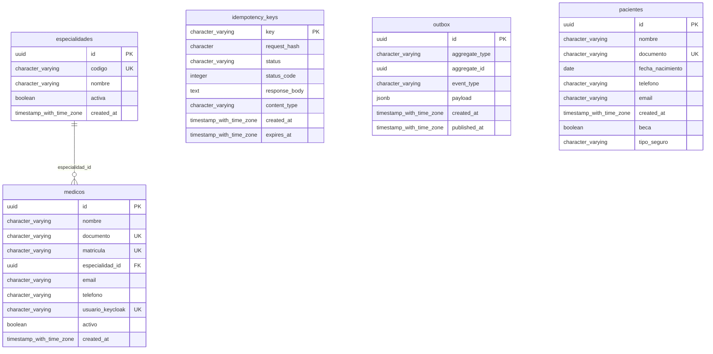
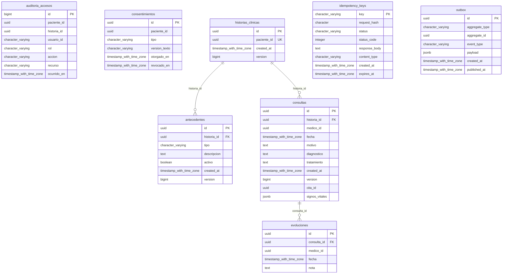
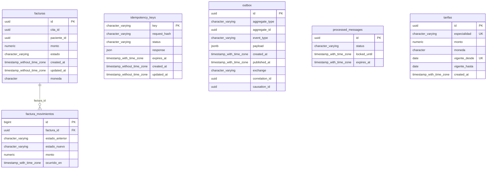
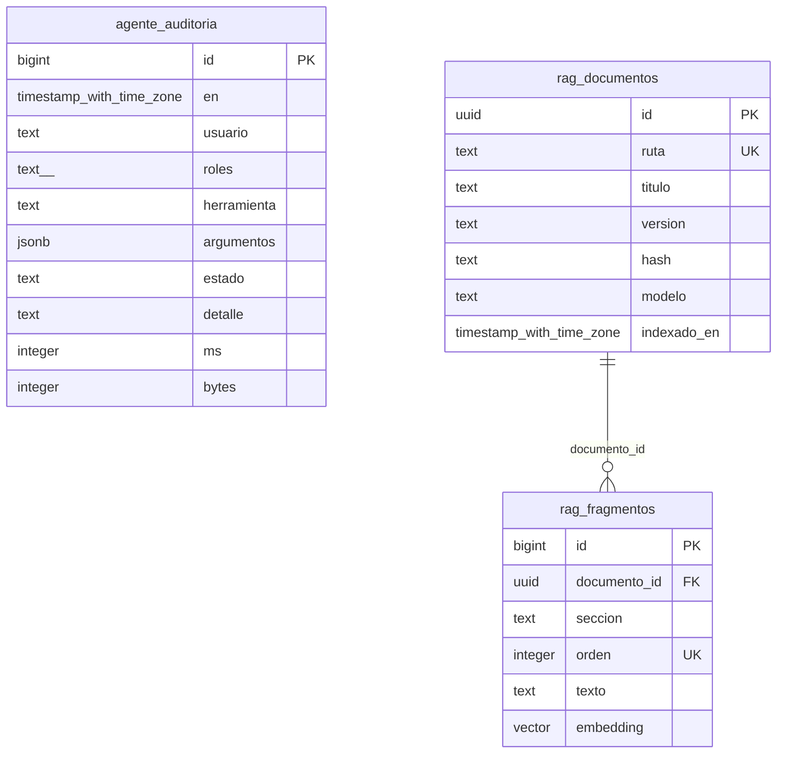

# Diagramas entidad-relacion generados

> Generado por `make datos-docs` desde las bases reales (claves y claves foraneas de cada base; las referencias **entre** bases estan en [README.md](README.md)).

## ms2_pacientes

## ms4_historias

## ms6_facturacion

## ms7_inteligencia

