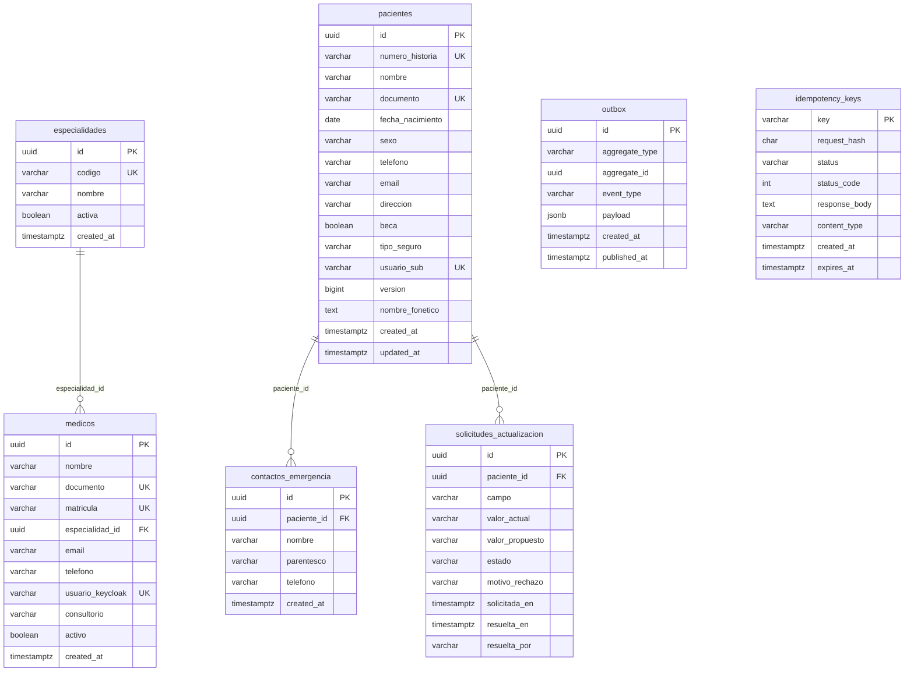
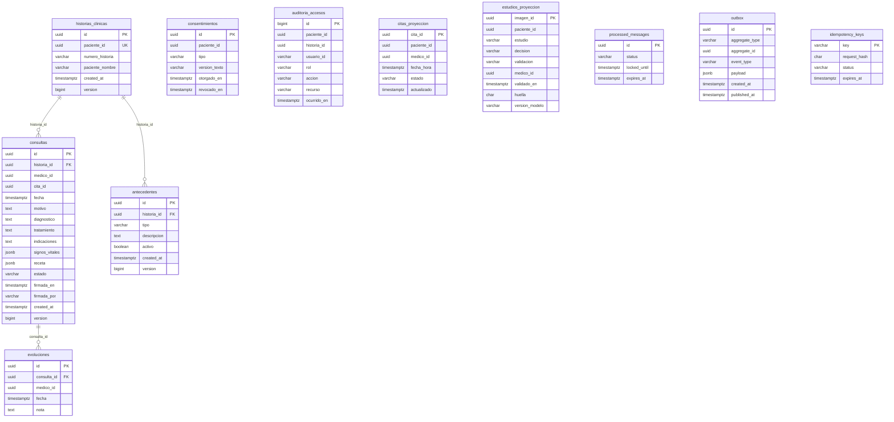
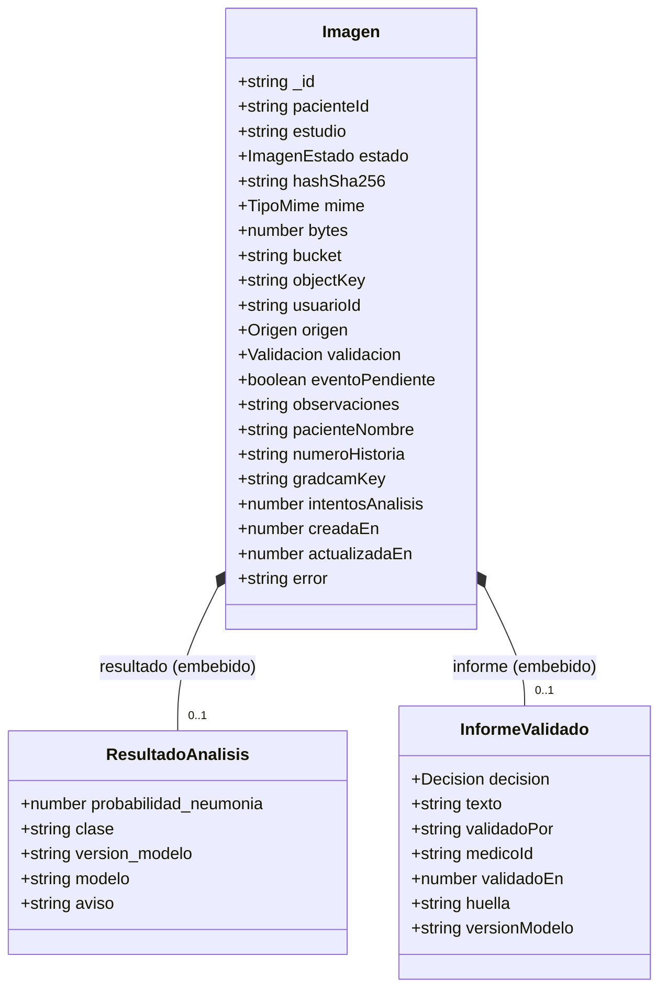
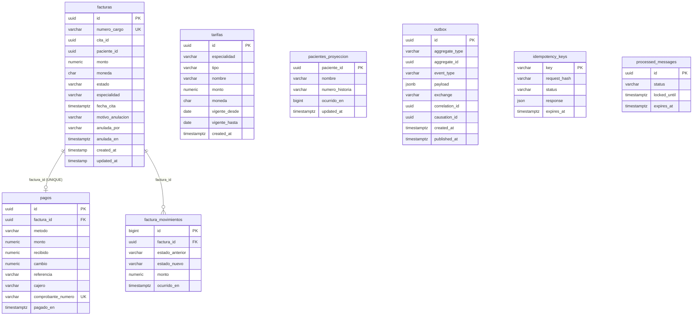
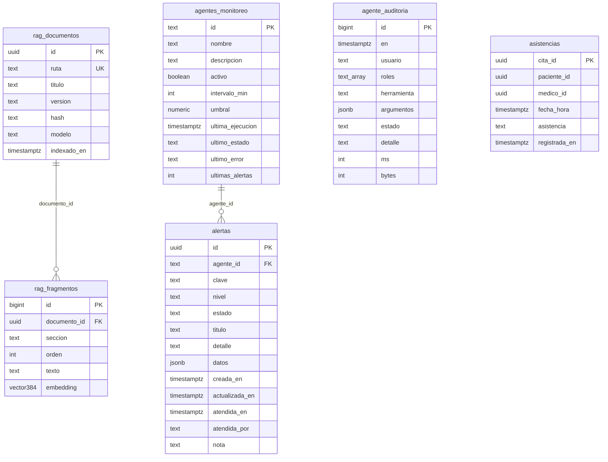

# SIGEC: bases de datos por servicio (insumo para diagramas)

Documento pensado para que un agente genere **Diagrama de dominio**, **Diagrama de datos** (ER / modelo fisico) y **Diagrama de clases**.
Fuente: migraciones SQL (Flyway / Laravel / `NNNN_*.sql`), `scripts/dynamodb-init.mjs`, `scripts/mongo-init/esquema.mjs` y clases de dominio de cada servicio.
Es el estado **actual del codigo** (incluye MS2 V4, MS4 V5, MS6 hasta `2026_11_07`, MS7 `0003`); donde `docs/datos/mongodb.md` o `erd-generado.md` difieren, manda este.

## 0. Reglas globales (aplican a todos los diagramas)

- **Una base por servicio; NO hay claves foraneas entre bases.** Las referencias entre servicios son UUID "blandos" (dibujar con linea punteada, etiqueta `ref blanda`). Solo las FK dentro de una misma base son reales (linea continua).
- Ids: `uuid` generado por la aplicacion. Dinero: `numeric(12,2)` + moneda (`BOB`). Fechas: `timestamptz` UTC (DynamoDB: epoch ms o ISO UTC).
- Cada servicio SQL (MS2, MS4, MS6) tiene tablas tecnicas **sin relaciones**: `outbox`, `idempotency_keys` (y `processed_messages` en MS4/MS6). Dibujarlas aparte o en un paquete "tecnicas".
- Inventario de almacenes:

| Servicio | Motor | Base / almacen | Seccion |
|---|---|---|---|
| MS2 Pacientes (+catalogo medicos/especialidades) | PostgreSQL 16 | `ms2_pacientes` | 1 |
| MS3 Citas (SAGA) | DynamoDB | `citas` (+ tablas tecnicas) | 2 |
| MS4 Historias clinicas | PostgreSQL 16 | `ms4_historias` | 3 |
| MS5 Imagenes | MongoDB 7 (+S3 para binarios) y DynamoDB (idempotencia) | `sigec_imagenes.imagenes`, `ms5_idempotency_keys` | 4 |
| MS6 Facturacion | PostgreSQL 16 | `ms6_facturacion` | 5 |
| MS7 Inteligencia | PostgreSQL 16 + pgvector | `ms7_inteligencia` | 6 |
| MS8 Notificaciones | DynamoDB | `notificaciones` (+ `ms8_*`) | 7 |
| MS1 Identidad / Keycloak / n8n | — | MS1 sin base propia; Keycloak y n8n usan sus propias bases PostgreSQL (`keycloak`, `n8n`), **fuera de alcance** | 8 |

---

## 1. MS2 Pacientes — PostgreSQL `ms2_pacientes`

### 1.1 Tablas

**especialidades** — catalogo. `id uuid PK`, `codigo varchar(40) UNIQUE NOT NULL CHECK ^[a-z0-9_]+$` (clave natural usada por MS3/MS6), `nombre varchar(100) NOT NULL`, `activa boolean NOT NULL default true`, `created_at timestamptz`.

**medicos** — `id uuid PK`, `nombre varchar(200) NOT NULL`, `documento varchar(30) UNIQUE NOT NULL`, `matricula varchar(30) UNIQUE NOT NULL`, `especialidad_id uuid NOT NULL FK→especialidades.id`, `email varchar(200)`, `telefono varchar(30)`, `usuario_keycloak varchar(100) UNIQUE` (preferred_username), `consultorio varchar(30)`, `activo boolean default true`, `created_at timestamptz`. Indice parcial `(especialidad_id) WHERE activo`.

**pacientes** — `id uuid PK`, `numero_historia varchar(12) UNIQUE NOT NULL` (`HC-000123`, default desde `seq_numero_historia`), `nombre varchar(200) NOT NULL`, `documento varchar(30) UNIQUE NOT NULL`, `fecha_nacimiento date NOT NULL (>=1900-01-01)`, `sexo varchar(5) CHECK IN (F,M,OTRO)`, `telefono varchar(30)`, `email varchar(200)`, `direccion varchar(300)`, `beca boolean default false`, `tipo_seguro varchar(20) default 'NINGUNO' CHECK IN (NINGUNO,PUBLICO,PRIVADO)`, `usuario_sub varchar(100) UNIQUE` (sub Keycloak del portal), `version bigint default 0` (concurrencia optimista), `created_at`, `updated_at timestamptz`, `nombre_fonetico text GENERATED ALWAYS AS sigec_fonetica(nombre) STORED` (solo busqueda; indice GIN `pg_trgm`).

**contactos_emergencia** — `id uuid PK`, `paciente_id uuid NOT NULL FK→pacientes.id ON DELETE CASCADE`, `nombre varchar(200)`, `parentesco varchar(60)`, `telefono varchar(30)`, `created_at`.

**solicitudes_actualizacion** — `id uuid PK`, `paciente_id uuid NOT NULL FK→pacientes.id ON DELETE CASCADE`, `campo varchar(20) CHECK IN (telefono,email,direccion)`, `valor_actual varchar(300)`, `valor_propuesto varchar(300) NOT NULL`, `estado varchar(12) default 'PENDIENTE' CHECK IN (PENDIENTE,APROBADA,RECHAZADA)`, `motivo_rechazo varchar(300)`, `solicitada_en timestamptz`, `resuelta_en timestamptz`, `resuelta_por varchar(100)`. Unico parcial `(paciente_id, campo) WHERE estado='PENDIENTE'`.

**Tecnicas (sin relaciones):**
- `outbox`: `id uuid PK`, `aggregate_type varchar(100)`, `aggregate_id uuid`, `event_type varchar(100)`, `payload jsonb`, `created_at`, `published_at` (NULL = pendiente).
- `idempotency_keys`: `key varchar PK`, `request_hash char(64)`, `status varchar`, `status_code int`, `response_body text`, `content_type varchar`, `created_at`, `expires_at`.

### 1.2 Relaciones (reales)

- `especialidades 1 ── 0..* medicos` (medicos.especialidad_id)
- `pacientes 1 ── 0..* contactos_emergencia` (cascade)
- `pacientes 1 ── 0..* solicitudes_actualizacion` (cascade)



### 1.3 Clases de dominio (Java, hexagonal, `domain/model`; todas son `record` inmutables)

| Clase | Atributos | Metodos |
|---|---|---|
| `Paciente` | id: UUID, numeroHistoria, nombre, documento, fechaNacimiento: LocalDate, sexo: Sexo, telefono, email, direccion, beca: boolean, tipoSeguro: TipoSeguro, usuarioSub, version: long, createdAt, updatedAt: Instant | `crear(...)`, `actualizar(...)`, `conContacto(campo, valor)`, `contacto(campo)` |
| `Medico` | id, nombre, documento, matricula, especialidadId: UUID, email, telefono, usuarioKeycloak, consultorio, activo | `crear(...)`, `actualizar(...)` |
| `Especialidad` | id, codigo, nombre, activa | `crear`, `actualizar` |
| `ContactoEmergencia` | id, pacienteId, nombre, parentesco, telefono, createdAt | `crear` |
| `SolicitudActualizacion` | id, pacienteId, campo: Campo, valorActual, valorPropuesto, estado: Estado, motivoRechazo, solicitadaEn, resueltaEn, resueltaPor | `crear`, `aprobar(usuario)`, `rechazar(usuario, motivo)` |
| enums | `Sexo{F,M,OTRO}`, `TipoSeguro{NINGUNO,PUBLICO,PRIVADO}`, `SolicitudActualizacion.Campo{TELEFONO,EMAIL,DIRECCION}`, `SolicitudActualizacion.Estado{PENDIENTE,APROBADA,RECHAZADA}` | |
| eventos (`domain/event`) | `DomainEvent` (interfaz) ← `PacienteCreado`, `PacienteActualizado`, `MedicoCreado`, `MedicoActualizado` | |
| excepciones | `DominioException` ← `RecursoNoEncontradoException`, `ConflictoException`, `ReglaNegocioException`, `VersionConflictoException`, `CursorInvalidoException`, `PacienteDuplicadoException`, `PacienteNoEncontradoException` | |

Asociaciones de clase: `Medico → Especialidad` (por `especialidadId`), `ContactoEmergencia → Paciente`, `SolicitudActualizacion → Paciente` (por id; en el modelo de dominio son referencias por UUID, no objetos).

---

## 2. MS3 Citas — DynamoDB (single-table `citas`)

DynamoDB no tiene FK ni esquema fijo: dibujar como **tabla con tipos de item** (entidades por prefijo de `pk`/`sk`). Todas las tablas son on-demand.

### 2.1 Tabla `citas` — clave `pk` (HASH, S) + `sk` (RANGE, S); TTL `expiresAt`

| Tipo de item | pk | sk | Atributos |
|---|---|---|---|
| **Cita (agregado + SAGA)** | `CITA#<citaId>` | `CITA` | `input{pacienteId, medicoId, especialidad, fechaHora ISO}`, `estado` (PENDIENTE, RESERVADA, COBRO_PROVISIONAL, CONFIRMADA, CANCELADA, ANULADA, CANCELADA_USUARIO, EN_SALA, ATENDIDA, NO_ASISTIO), `facturaId?`, `motivoFallo?`, `notificacion{estado NO_APLICA/PENDIENTE/ENVIADA, intentos, proximoIntento?}`, `saga{sagaId, estado EN_CURSO/COMPLETADA/COMPENSADA, paso COBRO_PROVISIONAL/NOTIFICACION/FIN, intentos, deadline, cobroSolicitado, anulacionCobro?, compensaciones[], historial[{at,paso,evento,detalle?}]}`, `asistencia? (ASISTIO/NO_ASISTIO)`, `llegadaEn?`, `cancelacion?{motivo,por,at}`, `reprogramaciones?[{desde,hacia,por,at}]`, `createdAt`, `updatedAt` (epoch ms), `version` (optimista), claves de indices |
| **Horario** | `HORARIO#<medicoId>` | `<fechaHora ISO UTC>` | `estado` (LIBRE, RESERVADO, CONFIRMADO, BLOQUEADO), `citaId?`, `reservaExpiraEn?` (epoch ms, solo RESERVADO), `motivo?` (solo BLOQUEADO), `expiresAt?` (TTL de horarios LIBRE de semilla) |

**Indices secundarios globales** (todos se alimentan del item Cita):

| GSI | Particion (S) | Orden (N) | Proyeccion | Uso |
|---|---|---|---|---|
| `gsi1` (disperso) | `SAGA#ACTIVA` o `NOTIF#PENDIENTE` | plazo / proximo intento (epoch ms) | KEYS_ONLY | barrido de SAGAs vencidas y notificaciones a reintentar |
| `gsi2` | `PACIENTE#<id>` | fecha creacion | ALL | mis citas |
| `gsi3` | `MEDICO#<id>` | fecha de la cita | ALL | agenda del medico |
| `gsi4` | `CITA` (una particion) | fecha creacion | ALL | listado general |

Condiciones clave (anti doble reserva): crear cita `attribute_not_exists(pk)`; actualizar por `version`; `RESERVAR` si no existe, `LIBRE` o reserva vencida; `CONFIRMAR` si `RESERVADO` y `citaId` coincide. Todo viaja en una `TransactWriteItems` junto al item de `outbox`.

### 2.2 Tablas tecnicas MS3

| Tabla | pk | sk | TTL | Otros |
|---|---|---|---|---|
| `idempotency_keys` | `<sub>:<Idempotency-Key>` | — | `expiresAt` (24 h) | |
| `outbox` | id del sobre | — | — | Stream `NEW_IMAGE`; atributos `exchange`, `routingKey`, `envelope` (JSON), `createdAt` |
| `processed_messages` | id del mensaje | — | `expiresAt` | `status` (PROCESANDO/COMPLETADO), `lockedUntil` |

```mermaid
erDiagram
  CITA_ITEM ||--o{ HORARIO_ITEM : "citaId (cuando RESERVADO/CONFIRMADO)"
  CITA_ITEM {
    string pk "CITA#citaId"
    string sk "CITA"
    json input "pacienteId, medicoId, especialidad, fechaHora"
    string estado
    string facturaId
    json saga
    json notificacion
    string asistencia
    number version
    number createdAt
    number updatedAt
    string gsi1pk
    number gsi1sk
    string gsi2pk "PACIENTE#id"
    string gsi3pk "MEDICO#id"
    string gsi4pk "CITA"
  }
  HORARIO_ITEM {
    string pk "HORARIO#medicoId"
    string sk "fechaHora ISO UTC"
    string estado
    string citaId
    number reservaExpiraEn
    string motivo
    number expiresAt
  }
```

### 2.3 Clases de dominio (TypeScript, `src/domain/cita.ts`)

```
CitaAggregate { citaId, input: CitaInput, estado: CitaEstado, facturaId?, motivoFallo?, notificacion: NotificacionInfo, saga: SagaState,
                asistencia?: Asistencia, llegadaEn?, cancelacion?: Cancelacion, reprogramaciones?: Reprogramacion[], createdAt, updatedAt, version }
CitaInput     { pacienteId, medicoId, especialidad, fechaHora }
NotificacionInfo { estado, intentos, proximoIntento? }
SagaState     { sagaId, estado: SagaEstado, paso: SagaPaso, intentos, deadline, cobroSolicitado, anulacionCobro?, compensaciones[], historial: HistorialEntry[] }
HistorialEntry{ at, paso, evento, detalle? }
Cancelacion   { motivo, por, at }        Reprogramacion { desde, hacia, por, at }
Horario       { medicoId, fechaHora, estado: HorarioEstado, citaId?, reservaExpiraEn?, motivo? }
HorarioOp     = RESERVAR | CONFIRMAR | LIBERAR | TOMAR  { medicoId, fechaHora, citaId, expiraEn? }
SagaCommand   { type, exchange?, payload }     OutboxMessage { id, exchange, type, correlationId, causationId, payload }
Enums: CitaEstado, Asistencia, NotificacionEstado, SagaEstado, SagaPaso, HorarioEstado
Errores: HorarioNoDisponibleError, ConcurrentUpdateError, HorarioPerdidoError, SolicitudInvalidaError, NoEncontradoError, CitaNoEncontradaError, TransicionInvalidaError
```

Composicion: `CitaAggregate` *compone* `CitaInput`, `NotificacionInfo`, `SagaState` (que compone `HistorialEntry[]`), `Cancelacion?`, `Reprogramacion[]`. `Horario` se asocia a `CitaAggregate` por `citaId` (0..1) y a un medico (MS2) por `medicoId`.

---

## 3. MS4 Historias clinicas — PostgreSQL `ms4_historias`

### 3.1 Tablas

**historias_clinicas** — `id uuid PK`, `paciente_id uuid UNIQUE NOT NULL` (ref blanda MS2), `numero_historia varchar(30)` (copia de MS2, unico parcial), `paciente_nombre varchar(200)` (copia de MS2), `created_at`, `version bigint default 0 CHECK >=0`.

**consultas** — `id uuid PK`, `historia_id uuid NOT NULL FK→historias_clinicas.id`, `medico_id uuid NOT NULL` (ref blanda MS2), `cita_id uuid` (ref blanda MS3; unico parcial, NULL = sin cita), `fecha timestamptz NOT NULL`, `motivo text NOT NULL`, `diagnostico text`, `tratamiento text`, `indicaciones text`, `signos_vitales jsonb`, `receta jsonb NOT NULL default '[]'` (lista de `{medicamento,dosis,frecuencia,duracion}`), `estado varchar(10) default 'BORRADOR' CHECK IN (BORRADOR,FIRMADA)`, `firmada_en timestamptz`, `firmada_por varchar(100)` (sub Keycloak; CHECK `(estado='FIRMADA') = (firmada_en IS NOT NULL)`), `created_at`, `version bigint`.

**antecedentes** — `id uuid PK`, `historia_id uuid NOT NULL FK→historias_clinicas.id`, `tipo varchar(20) CHECK IN (ALERGIA,PERSONAL,FAMILIAR,QUIRURGICO,MEDICACION)`, `descripcion text NOT NULL`, `activo boolean default true`, `created_at`, `version bigint`.

**evoluciones** — **inmutable** (trigger rechaza UPDATE/DELETE). `id uuid PK`, `consulta_id uuid NOT NULL FK→consultas.id`, `medico_id uuid NOT NULL` (ref blanda MS2), `fecha timestamptz`, `nota text NOT NULL`.

**consentimientos** — `id uuid PK`, `paciente_id uuid NOT NULL` (ref blanda MS2; **sin FK**), `tipo varchar(30) CHECK IN (TRATAMIENTO_DATOS,IMAGENES_IA,NOTIFICACIONES)`, `version_texto varchar(20)`, `otorgado_en timestamptz`, `revocado_en timestamptz` (>= otorgado_en). Unico parcial `(paciente_id,tipo) WHERE revocado_en IS NULL`.

**auditoria_accesos** — **append-only** (trigger). `id bigint IDENTITY PK`, `paciente_id uuid NOT NULL`, `historia_id uuid`, `usuario_id varchar(100)` (sub), `rol varchar(30)`, `accion varchar(20) CHECK IN (LEER,CREAR,MODIFICAR,EXPORTAR)`, `recurso varchar(40)`, `ocurrido_en timestamptz`. Sin FK (solo ids).

**citas_proyeccion** — proyeccion local de eventos `cita.*` de MS3. `cita_id uuid PK`, `paciente_id uuid`, `medico_id uuid`, `fecha_hora timestamptz`, `estado varchar(20) CHECK IN (CONFIRMADA,CANCELADA,LLEGO,ATENDIDA,NO_ASISTIO)`, `actualizado timestamptz`. Sin FK.

**estudios_proyeccion** — proyeccion de `imagen.informe-validado` de MS5. `imagen_id uuid PK`, `paciente_id uuid`, `estudio varchar(100)`, `decision varchar(10) CHECK IN (CONFIRMA,MODIFICA,DESCARTA)`, `validacion varchar(10) CHECK IN (VALIDADO,DESCARTADO)`, `medico_id uuid`, `validado_en timestamptz`, `huella char(64)`, `version_modelo varchar(50)`. Sin FK.

**Tecnicas:** `outbox` (igual a MS2), `idempotency_keys` (igual a MS2), `processed_messages` (`id uuid PK`, `status` PROCESANDO/COMPLETADO, `locked_until`, `expires_at`).

### 3.2 Relaciones (reales)

- `historias_clinicas 1 ── 0..* consultas`
- `historias_clinicas 1 ── 0..* antecedentes`
- `consultas 1 ── 0..* evoluciones`
- (logica, sin FK) `historias_clinicas.paciente_id ↔ consentimientos.paciente_id ↔ auditoria_accesos.paciente_id ↔ citas_proyeccion.paciente_id ↔ estudios_proyeccion.paciente_id`; `consultas.cita_id → citas_proyeccion.cita_id`.



### 3.3 Clases de dominio (Java, `domain/model`, records)

| Clase | Atributos |
|---|---|
| `Historia` | id, pacienteId, numeroHistoria, pacienteNombre, creada: Instant, version: long |
| `Consulta` | id, historiaId, medicoId, citaId?, fecha, motivo, diagnostico, tratamiento, indicaciones, signosVitales: Map<String,Object>, receta: List<RecetaItem>, estado: EstadoConsulta, firmadaEn?, firmadaPor?, version. Metodos: `nueva`, `editar`, `firmar(usuario, ahora)`, `firmada()` |
| `RecetaItem` (valor) | medicamento, dosis, frecuencia, duracion |
| `Antecedente` | id, historiaId, tipo: TipoAntecedente, descripcion, activo, creado, version. `nuevo`, `editar` |
| `Evolucion` | id, consultaId, medicoId, fecha, nota (inmutable) |
| `Consentimiento` | id, pacienteId, tipo: TipoConsentimiento, versionTexto, otorgadoEn, revocadoEn?. `vigente()` |
| `AccesoAuditado` | id, pacienteId, historiaId?, usuarioId, rol, accion: Accion, recurso, ocurridoEn |
| `CitaProyectada` | citaId, pacienteId, medicoId, fechaHora, estado. `habilitaConsulta()` |
| `EstudioValidado` | imagenId, pacienteId, estudio, decision, validacion, medicoId, validadoEn, huella, versionModelo |
| enums | `EstadoConsulta{BORRADOR,FIRMADA}`, `TipoAntecedente{ALERGIA,PERSONAL,FAMILIAR,QUIRURGICO,MEDICACION}`, `TipoConsentimiento{TRATAMIENTO_DATOS,IMAGENES_IA,NOTIFICACIONES}`, `Accion{LEER,CREAR,MODIFICAR,EXPORTAR}` |
| eventos | `DomainEvent` ← `ConsultaFirmada` |
| excepciones | `DominioException` ← `RecursoNoEncontrado`, `Conflicto`, `ReglaNegocio`, `VersionConflicto`, `CursorInvalido`, `AccesoDenegado` |

Agregado raiz: `Historia` (1) → (0..*) `Consulta` → (0..*) `Evolucion`; `Historia` → (0..*) `Antecedente`. `Consulta` *compone* `RecetaItem[]`.

---

## 4. MS5 Imagenes — MongoDB `sigec_imagenes` + S3 + DynamoDB

### 4.1 Coleccion `imagenes` (documentos; `validationLevel: strict`, `additionalProperties: false`)

| Campo | Tipo BSON | Req. | Notas |
|---|---|---|---|
| `_id` | string (uuid) | si | |
| `pacienteId` | string | si | ref blanda MS2 |
| `estudio` | string | si | p. ej. `torax-pa` |
| `estado` | enum | si | SUBIDA, ANALIZANDO, ANALIZADA, FALLIDA |
| `hashSha256` | string (64 hex) | si | |
| `mime` | enum | si | image/jpeg, image/png, application/dicom |
| `bytes` | number >= 0 | si | |
| `bucket`, `objectKey` | string | si | ubicacion S3 (objectKey unico, nunca expuesto) |
| `usuarioId` | string | si | sub Keycloak de quien subio |
| `origen` | enum | no | MEDICO, PACIENTE (quien subio el estudio) |
| `validacion` | enum | no | PENDIENTE, VALIDADO, DESCARTADO |
| `resultado` | **objeto embebido** | no | `{probabilidad_neumonia 0..1, clase NEUMONIA/NORMAL, version_modelo, modelo, aviso}` |
| `informe` | **objeto embebido** | no | `{decision CONFIRMA/MODIFICA/DESCARTA, texto|null, validadoPor, medicoId|null, validadoEn, huella (64 hex), versionModelo|null}` |
| `error` | string | no | motivo si FALLIDA |
| `eventoPendiente` | bool | no | evento `imagen.informe-validado` aun sin publicar |
| `observaciones`, `pacienteNombre`, `numeroHistoria` | string | no | copias de MS2 para buscar |
| `gradcamKey` | string | no | clave S3 del mapa de calor |
| `intentosAnalisis` | number >= 0 | no | |
| `creadaEn`, `actualizadaEn` | number (epoch ms) | si | |

**Indices:** `{pacienteId,creadaEn:-1,_id:-1}`; `{estado,actualizadaEn}`; `{validacion,creadaEn:-1,_id:-1}`; `{pacienteId,hashSha256}`; `{eventoPendiente}` (sparse); `{hashSha256}`; `{objectKey}` **unico**. Sin TTL.

**S3 (SeaweedFS):** bucket privado con el binario de la imagen (`objectKey`) y el mapa de calor (`gradcamKey`); no es una "base" a diagramar, solo un almacen referenciado.

### 4.2 DynamoDB MS5
`ms5_idempotency_keys`: `pk` = `<sub>:<Idempotency-Key>`, TTL `expiresAt`.


Enums: `ImagenEstado{SUBIDA,ANALIZANDO,ANALIZADA,FALLIDA}`, `Origen{MEDICO,PACIENTE}`, `Validacion{PENDIENTE,VALIDADO,DESCARTADO}`, `Decision{CONFIRMA,MODIFICA,DESCARTA}`, `TipoMime`. Errores: `ReglaImagenError`, `ArchivoInvalidoError`, `PacienteInexistenteError`, `ServicioNoDisponibleError`.

---

## 5. MS6 Facturacion — PostgreSQL `ms6_facturacion` (Laravel)

### 5.1 Tablas

**facturas** (cargo) — `id uuid PK`, `numero_cargo varchar(24) UNIQUE NOT NULL` (`CG-AAAAMMDD-NNNN`), `cita_id uuid NOT NULL` (ref blanda MS3; unico parcial `WHERE estado <> 'ANULADA'` = un cobro vigente por cita), `paciente_id uuid NOT NULL` (ref blanda MS2), `monto numeric(12,2) CHECK >=0`, `moneda char(3) default 'BOB'`, `estado varchar(20) default 'PENDIENTE'` (PENDIENTE, PROVISIONAL, CONFIRMADA, PAGADA, ANULADA), `especialidad varchar(40)`, `fecha_cita timestamptz`, `motivo_anulacion varchar(300)`, `anulada_por varchar(100)`, `anulada_en timestamptz`, `created_at`, `updated_at`.

**pagos** — `id uuid PK`, `factura_id uuid UNIQUE NOT NULL FK→facturas.id` (un cargo se cobra una sola vez), `metodo varchar(20) CHECK IN (EFECTIVO,TRANSFERENCIA,POS)`, `monto numeric(12,2)`, `recibido numeric(12,2)`, `cambio numeric(12,2) default 0`, `referencia varchar(100)` (obligatoria si no es EFECTIVO), `cajero varchar(100)`, `comprobante_numero varchar(12) UNIQUE` (`CI-000001`), `pagado_en timestamptz`.

**factura_movimientos** — ledger **inmutable** llenado por trigger. `id bigint PK`, `factura_id uuid NOT NULL FK→facturas.id`, `estado_anterior varchar`, `estado_nuevo varchar`, `monto numeric(12,2)`, `ocurrido_en timestamptz`.

**tarifas** — `id uuid PK`, `especialidad varchar(40)` (codigo de MS2 `especialidades.codigo`; **sin FK**), `tipo varchar(10) default 'CONSULTA' CHECK IN (CONSULTA,ESTUDIO)`, `nombre varchar(100)`, `monto numeric(12,2) >=0` (0 = sin tarifa), `moneda char(3) default 'BOB'`, `vigente_desde date`, `vigente_hasta date`, `created_at`. `UNIQUE(especialidad, vigente_desde)`.

**pacientes_proyeccion** — copia local de MS2 para listados de caja. `paciente_id uuid PK`, `nombre varchar(200)`, `numero_historia varchar(12)`, `ocurrido_en bigint`, `updated_at`. Sin FK.

**Tecnicas:** `outbox` (`id uuid PK`, `aggregate_type`, `aggregate_id`, `event_type`, `payload jsonb`, `exchange varchar(100) default 'sigec.eventos'`, `correlation_id uuid`, `causation_id uuid`, `created_at`, `published_at`), `idempotency_keys` (`key varchar(200) PK`, `request_hash varchar(64)`, `status`, `response json`, `expires_at`, `created_at`, `updated_at`), `processed_messages` (`id uuid PK`, `status`, `locked_until`, `expires_at`). `users`/`cache`/`jobs` de Laravel: no se usan, omitir.

### 5.2 Relaciones (reales)
- `facturas 1 ── 0..1 pagos`
- `facturas 1 ── 0..* factura_movimientos`
- (logica) `tarifas.especialidad ↔ facturas.especialidad ↔ MS2.especialidades.codigo`



### 5.3 Clases (Laravel Eloquent, `app/Models`)
- `Factura` — fillable: cita_id, paciente_id, monto, estado, especialidad, fecha_cita, motivo_anulacion, anulada_por, anulada_en. Constantes `ESTADOS = [PENDIENTE,PROVISIONAL,CONFIRMADA,PAGADA,ANULADA]`, `COBRABLES = [PENDIENTE,PROVISIONAL,CONFIRMADA]`. Relacion `hasOne(Pago)`.
- `Pago` — `belongsTo(Factura)`.
- `Tarifa` — independiente.
- (`User` de Laravel: omitir.)

---

## 6. MS7 Inteligencia — PostgreSQL + pgvector `ms7_inteligencia`

Migraciones propias `0001`–`0003` (extension `vector`).

### 6.1 Tablas

**rag_documentos** — `id uuid PK default gen_random_uuid()`, `ruta text UNIQUE NOT NULL`, `titulo text`, `version text`, `hash text` (SHA-256), `modelo text` (modelo de embeddings), `indexado_en timestamptz`.

**rag_fragmentos** — `id bigserial PK`, `documento_id uuid NOT NULL FK→rag_documentos.id ON DELETE CASCADE`, `seccion text`, `orden integer CHECK >=0`, `texto text`, `embedding vector(384) NOT NULL` (indice HNSW coseno m=16, ef_construction=64). `UNIQUE(documento_id, orden)`.

**agente_auditoria** — `id bigint IDENTITY PK`, `en timestamptz`, `usuario text` (sub), `roles text[]`, `herramienta text`, `argumentos jsonb`, `estado text CHECK IN (ok,error,rechazada)`, `detalle text`, `ms integer >=0`, `bytes integer >=0`. Sin FK.

**asistencias** — registrada desde el evento de MS3. `cita_id uuid PK`, `paciente_id uuid` (ref blanda), `medico_id uuid`, `fecha_hora timestamptz`, `asistencia text CHECK IN (LLEGO,ATENDIDA,NO_ASISTIO)`, `registrada_en timestamptz`.

**agentes_monitoreo** — 4 filas fijas. `id text PK CHECK IN (cancelaciones,inasistencias,demanda,ingresos)`, `nombre text`, `descripcion text`, `activo boolean default true`, `intervalo_min integer CHECK 5..1440`, `umbral numeric(8,3) >0`, `ultima_ejecucion timestamptz`, `ultimo_estado text CHECK IN (OK,ERROR)`, `ultimo_error text`, `ultimas_alertas integer >=0`.

**alertas** — `id uuid PK default gen_random_uuid()`, `agente_id text NOT NULL FK→agentes_monitoreo.id`, `clave text`, `nivel text CHECK IN (BAJO,MEDIO,ALTO)`, `estado text default 'ABIERTA' CHECK IN (ABIERTA,ATENDIDA)`, `titulo text`, `detalle text`, `datos jsonb`, `creada_en`, `actualizada_en`, `atendida_en`, `atendida_por text`, `nota text`. Unico parcial `(clave) WHERE estado='ABIERTA'`.

### 6.2 Relaciones (reales)
- `rag_documentos 1 ── 0..* rag_fragmentos` (cascade)
- `agentes_monitoreo 1 ── 0..* alertas`



Otros componentes de MS7 (sin base propia, para el diagrama de dominio): API FastAPI de ML (modelos de inasistencia y K-means), GraphQL de gestion, servidor MCP + agente, reportes xlsx/csv/pdf, servicio de embeddings y Whisper (voz). Leen datos de MS3/MS6 por HTTP con el token del usuario.

---

## 7. MS8 Notificaciones — DynamoDB (single-table `notificaciones`)

### 7.1 Tabla `notificaciones` — `pk` (HASH, S) + `sk` (RANGE, S); TTL `expiresAt`

| Tipo de item | pk | sk | Atributos | Indice |
|---|---|---|---|---|
| **Notificacion** | `CITA#<citaId>` | `NOTIF#<clave>` (`clave` = tipo; reprogramacion = `CITA_REPROGRAMADA@<fechaHora>`) | id, citaId, pacienteId, tipo, estado (PENDIENTE/ENVIADA/FALLIDA), canalesEnviados[], intentos, proximoIntento?, ultimoError?, reenviada?, leida?, leidaEn?, fechaHora?, motivo?, correlationId?, comandoId?, creadaEn, actualizadaEn, version | `gsi1` = `NOTIF#PENDIENTE` por proximoIntento (disperso); `gsi3` = `PACIENTE#<id>` por creacion; `gsi4` = `NOTIF` por creacion |
| **Puntero** | `NOTIF#<id>` | `PTR` | refPk, refSk (busqueda por id de notificacion) | — |
| **Recordatorio** | `CITA#<citaId>` | `RECORDATORIO` | citaId, pacienteId, fechaHora, marcado, cancelada? | `gsi2` = `RECORDATORIO#PENDIENTE` por fecha de la cita (se quita al marcarse) |
| **Contacto** | `PACIENTE#<pacienteId>` | `CONTACTO` | nombre?, email, canales[] (EMAIL/TELEGRAM), telegramChatId?, tiposAviso?[], antelacionHoras? (2/6/12/24/48) | — |
| **Vinculo Telegram** | `VINCULO#<codigo>` | `VINCULO` | pacienteId, expiraEn, usado | TTL `expiresAt` (codigo + 1 h) |
| **Plantilla (versionada)** | `PLANTILLA#<tipo>#<canal>` | `V#<n 6 digitos>` | tipo, canal, asunto, cuerpo, version, actualizadoPor, actualizadoEn | — |
| **Preferencias personal** | `USUARIO#<sub>` | `PREFERENCIAS` | alertas{sagaCompensada, notificacionFallida, colaDeErrores}, actualizadaEn | — |

Tablas tecnicas MS8 (misma forma que las de MS3): `ms8_idempotency_keys` (TTL), `ms8_outbox` (Stream), `ms8_processed_messages` (TTL).

```mermaid
erDiagram
  CONTACTO ||--o{ NOTIFICACION : "pacienteId"
  CONTACTO ||--o{ VINCULO_TELEGRAM : "pacienteId"
  NOTIFICACION ||--o| RECORDATORIO : "citaId"
  PLANTILLA }o--o{ NOTIFICACION : "tipo + canal (render)"
  CONTACTO { string pk "PACIENTE#id"
    string sk "CONTACTO"
    string email
    string canales
    string telegramChatId
    string tiposAviso
    number antelacionHoras }
  NOTIFICACION { string pk "CITA#id"
    string sk "NOTIF#clave"
    string tipo
    string estado
    string canalesEnviados
    number intentos
    number proximoIntento
    number version }
  RECORDATORIO { string pk "CITA#id"
    string sk "RECORDATORIO"
    string fechaHora
    boolean marcado }
  VINCULO_TELEGRAM { string pk "VINCULO#codigo"
    string sk "VINCULO"
    string pacienteId
    number expiraEn
    boolean usado
    number expiresAt }
  PLANTILLA { string pk "PLANTILLA#tipo#canal"
    string sk "V#n"
    string asunto
    string cuerpo
    number version }
```

### 7.2 Clases de dominio (TypeScript, `src/domain/notificacion.ts`)

```
Notificacion { id, citaId, pacienteId, tipo: NotificacionTipo, estado: NotificacionEstado, canalesEnviados: Canal[], intentos, proximoIntento?, ultimoError?,
               reenviada?, leida?, leidaEn?, fechaHora?, motivo?, correlationId?, comandoId?, creadaEn, actualizadaEn, version }
Contacto     { pacienteId, nombre?, email?, canales: Canal[], telegramChatId?, tiposAviso?: NotificacionTipo[], antelacionHoras? }
CitaRecordable { citaId, pacienteId, fechaHora }
Plantilla    { tipo, canal, asunto, cuerpo, version, actualizadoPor, actualizadoEn }
PreferenciasPersonal { usuarioId, alertas{sagaCompensada, notificacionFallida, colaDeErrores}, actualizadaEn }
RespuestaSaga { id, type, correlationId, causationId, payload }
Enums: Canal{EMAIL,TELEGRAM}; NotificacionTipo{CITA_CONFIRMADA, CITA_CANCELADA, CITA_REPROGRAMADA, RECORDATORIO, RECORDATORIO_REFUERZO, ESTUDIO_VALIDADO};
       NotificacionEstado{PENDIENTE,ENVIADA,FALLIDA}
Errores: ReglaNotificacionError, VinculoInvalidoError, PreferenciasInvalidasError
```
`Notificacion` → `Contacto` (por pacienteId, 1..1), `Notificacion` → `Plantilla` (por tipo+canal, usa la ultima version). Para `ESTUDIO_VALIDADO`, `citaId` guarda el id del estudio.

---

## 8. MS1 Identidad, Keycloak y n8n (solo contexto)

- **MS1 Identidad**: servicio Nest sin base propia; administra usuarios en Keycloak (realm `sigec`; claims `sub`, roles, `paciente_id`).
- **Keycloak** y **n8n** usan bases PostgreSQL propias (`keycloak`, `n8n`) gestionadas por cada producto: **no diagramar**.
- `infra/postgres/init.sql` solo crea las bases y la extension `vector` en `ms7_inteligencia`.

---

## 9. Insumo para el **Diagrama de dominio**

Contextos delimitados (bounded contexts) = un servicio cada uno. Entidades/agregados por contexto:

| Contexto | Agregados / entidades | Conceptos de valor |
|---|---|---|
| Pacientes y catalogo (MS2) | **Paciente** (raiz) con ContactoEmergencia y SolicitudActualizacion; **Medico**; **Especialidad** | Sexo, TipoSeguro, numero de historia |
| Citas (MS3) | **Cita** (raiz, incluye SAGA); **Horario** | CitaInput, Cancelacion, Reprogramacion, Asistencia |
| Historias clinicas (MS4) | **Historia** (raiz) con Consulta (Evolucion), Antecedente; Consentimiento; AccesoAuditado | RecetaItem, signos vitales; proyecciones CitaProyectada, EstudioValidado |
| Imagenes (MS5) | **Imagen** (raiz) | ResultadoAnalisis, InformeValidado |
| Facturacion (MS6) | **Factura/Cargo** (raiz) con Pago y movimientos (ledger); **Tarifa** | Moneda, comprobante |
| Inteligencia (MS7) | DocumentoRAG→Fragmento; **AgenteMonitoreo**→Alerta; Asistencia; AuditoriaAgente | Embedding |
| Notificaciones (MS8) | **Notificacion**, **Contacto**, Plantilla, Recordatorio, VinculoTelegram, PreferenciasPersonal | Canal, TipoNotificacion |

### Relaciones entre contextos (ref blanda por id / evento) — para el diagrama de contexto y el de dominio

| Origen (servicio.campo) | Destino | Mecanismo |
|---|---|---|
| MS3 `Cita.input.pacienteId` | MS2 Paciente | id |
| MS3 `Cita.input.medicoId` | MS2 Medico | id |
| MS3 `Cita.input.especialidad` | MS2 Especialidad.codigo / MS6 Tarifa.especialidad | cadena |
| MS3 `Cita.facturaId` ↔ MS6 `Factura.cita_id` | MS6 Factura | SAGA por RabbitMQ (comando `cobro-provisional.solicitar` / evento `cobro-provisional.registrado`) |
| MS3 → MS8 | Notificacion | comando `cita-confirmada.enviar` (SAGA); MS8 responde por la misma SAGA |
| MS4 `Historia.paciente_id` | MS2 Paciente | evento `paciente.creado` |
| MS4 `Consulta.medico_id` | MS2 Medico | id |
| MS4 `Consulta.cita_id` | MS3 Cita | id opcional; proyeccion `citas_proyeccion` por eventos `cita.*` |
| MS4 `estudios_proyeccion` | MS5 Imagen | evento `imagen.informe-validado` |
| MS5 `Imagen.pacienteId` | MS2 Paciente | verificacion HTTP al subir |
| MS6 `Factura.paciente_id` y `pacientes_proyeccion` | MS2 Paciente | eventos `paciente.creado/actualizado` |
| MS8 `Contacto.pacienteId` | MS2 Paciente | evento `paciente.creado` |
| MS7 `asistencias` | MS3 Cita | evento `cita.asistencia-registrada` |
| MS7 (lectura) | MS3, MS6 | HTTP con el token del usuario |
| MS2 `Medico.usuario_keycloak`, `Paciente.usuario_sub`; `*.usuario_id`/`*_por` | Keycloak | claims JWT |

Infraestructura de mensajeria: RabbitMQ (exchanges `sigec.saga` y `sigec.eventos`), con **outbox** en cada servicio publicador (MS2, MS3, MS4, MS6, MS8; las tablas `outbox` estan en las secciones respectivas) y **processed_messages** para deduplicar consumidores.

## 10. Sugerencia de uso para el agente de diagramas

1. **Diagrama de dominio**: usar la seccion 9 (un paquete por contexto, agregados con su raiz, relaciones entre contextos punteadas).
2. **Diagrama de datos**: un diagrama por base (secciones 1, 3, 5, 6 en ER relacional; 2 y 7 como modelo de items DynamoDB con GSIs; 4 como documento Mongo con subdocumentos). No dibujar FK entre bases.
3. **Diagrama de clases**: secciones 1.3, 2.3, 3.3, 4 (classDiagram ya incluido), 5.3 y 7.2. Las clases de MS2/MS4 son `record` Java inmutables; MS3/MS5/MS8 son interfaces TypeScript; MS6 son modelos Eloquent.
