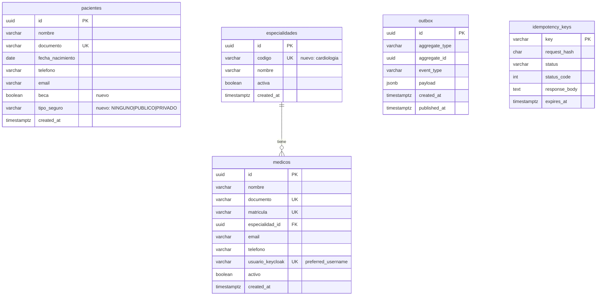
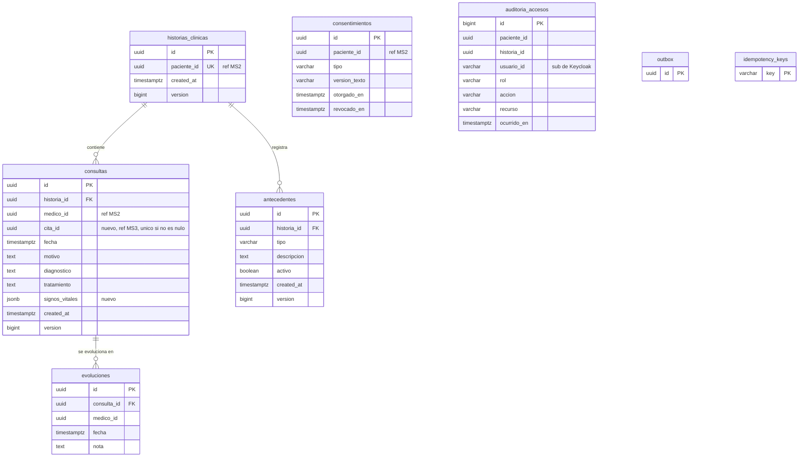
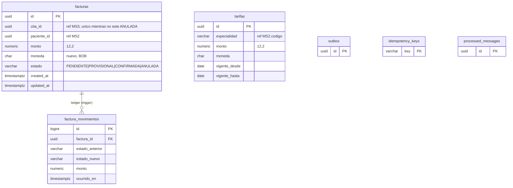
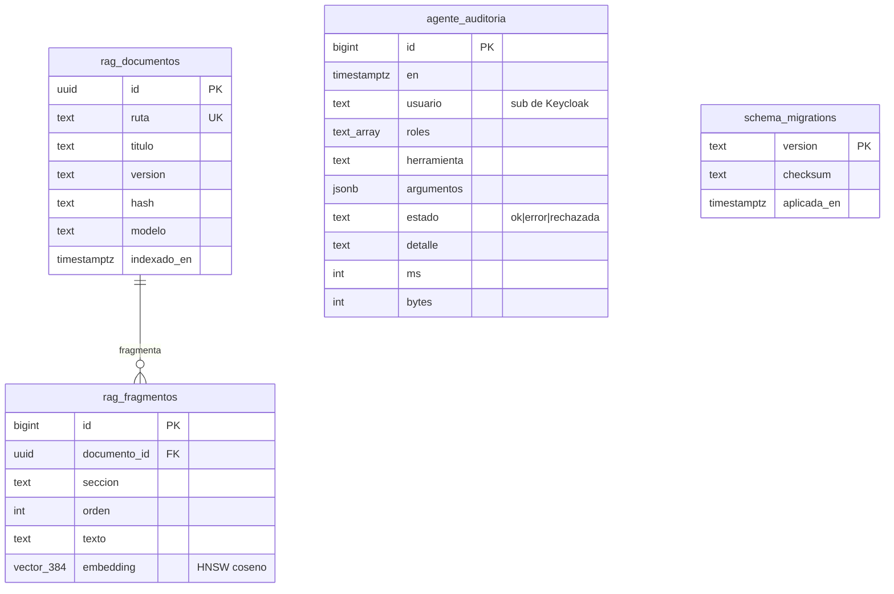

# PostgreSQL: diseno por base

Version de la imagen: `pgvector/pgvector:pg16`. Convenciones: `uuid` generado por la aplicacion (excepto tablas tecnicas), `timestamptz` en UTC, dinero `numeric(12,2)` con moneda `char(3)`,
cadenas con limite explicito, enumeraciones como `varchar` + `CHECK` (mas facil de migrar que `CREATE TYPE`), nombres en `snake_case` en espanol.
Los diagramas muestran el esquema **final** (existente + [nuevo]). El diccionario completo y generado esta en [diccionario.md](diccionario.md).

## ms2_pacientes (MS2, Flyway V1-V3)

- `pacientes.documento` UNIQUE (existente) evita duplicados; `CHECK` de nombre no vacio y fecha de nacimiento >= 1900 [nuevo].
- `edad` **no se guarda** (se calcula de `fecha_nacimiento`); `beca` y `tipo_seguro` alimentan el modelo de inasistencia de MS7.
- `medicos.especialidad_id` FK real (misma base). `usuario_keycloak` une al medico con su usuario sin tocar el realm.
- Indices: `idx_medicos_especialidad (especialidad_id) WHERE activo` (agenda/filtro por especialidad), UNIQUE implicitos de `codigo`, `documento`, `matricula`, `usuario_keycloak`.

## ms4_historias (MS4, Flyway V1-V3)

- `consultas`: la fila de una consulta es **corregible** (versionado optimista: `UPDATE ... WHERE version = ?`); la **evolucion** es **inmutable** (trigger que rechaza UPDATE/DELETE): lo escrito no se reescribe, se anade una nota nueva.
- `consultas.cita_id`: indice unico parcial (`WHERE cita_id IS NOT NULL`), una consulta por cita; `NULL` para urgencias.
- `consentimientos`: indice unico parcial `(paciente_id, tipo) WHERE revocado_en IS NULL` (un consentimiento vigente por tipo). Tipos: `TRATAMIENTO_DATOS`, `IMAGENES_IA`, `NOTIFICACIONES`.
- `auditoria_accesos`: solo ids y accion, **nunca contenido clinico**; append-only; indice BRIN por fecha (tabla casi ordenada por tiempo, indice minusculo) e indice `(paciente_id, ocurrido_en DESC)`.
- Indices: `(historia_id, fecha DESC)` (existente), `(medico_id, fecha DESC)` [nuevo: agenda clinica del medico], `(historia_id, tipo)` en antecedentes.
- `historias_clinicas.paciente_id` UNIQUE (existente): una historia por paciente.

## ms6_facturacion (MS6, migraciones Laravel)

- **Ledger:** `factura_movimientos` se llena con un trigger `AFTER INSERT OR UPDATE OF estado, monto` sobre `facturas` y es append-only (otro trigger lo protege). Cada cambio de estado (incluidas las anulaciones por compensacion y las "lapidas") queda trazado sin tocar el codigo PHP.
- **Tarifas:** una por `(especialidad, vigente_desde)`; la vigente es la de `vigente_desde <= hoy` y `(vigente_hasta IS NULL OR vigente_hasta > hoy)`; `CHECK (monto >= 0)` (0 = sin tarifa, se rechaza el cobro como hoy) y rango de fechas coherente. Si no hay fila, MS6 usa `config/facturacion.php`.
- `facturas`: `CHECK (monto >= 0)` (la lapida de anulacion lleva 0), indices existentes mas `(paciente_id, created_at DESC)` (listado "mis facturas" ordenado) y `(estado, created_at)` (informe de ingresos).
- Dinero: `numeric(12,2)`; nunca `float` en la base (el handler hoy hace `(float)` al leer la tarifa: se redondea a 2 decimales antes de guardar).
- `pagos`: **diseñado** (`id, factura_id FK, monto, metodo, referencia_externa, estado, created_at`); no se crea porque la SAGA no hace cobro definitivo.

## ms7_inteligencia (MS7, `NNNN_*.sql`)

- **pgvector:** `vector(384)` (modelo `paraphrase-multilingual-MiniLM-L12-v2`); indice `HNSW (embedding vector_cosine_ops) WITH (m = 16, ef_construction = 64)`.
  Se eligio HNSW (no IVFFlat) porque no necesita datos previos para entrenar listas y da buena recuperacion con pocos miles de fragmentos. En consulta: `SET LOCAL hnsw.ef_search = 40` (valor por defecto) y
  `ORDER BY embedding <=> $1 LIMIT k`; la similitud es `1 - distancia`. Cambiar de modelo = migracion nueva con otra dimension + reindexar.
- `agente_auditoria`: la escribe el adaptador `AuditoriaPg` en segundo plano (la lectura sigue en memoria; un fallo de la base nunca rompe una consulta; `AUDITORIA_PERSISTENTE=false` la desactiva). `argumentos` son los parametros ya validados con zod de cada herramienta (filtros, y la pregunta de `consultar_politicas`, que es texto administrativo); los datos de pacientes no llegan a esta capa (`redaccion.ts`). Indices `(en DESC)` y `(usuario, en DESC)`.
- No hay datos clinicos en esta base.

## Outbox, idempotencia y retencion (MS2, MS4, MS6)

| Tabla | Crecimiento | Politica |
|---|---|---|
| `outbox` | 1 fila por evento; el relay marca `published_at` | Se purgan filas **publicadas** de mas de 7 dias (`purgar_tecnico()`); las no publicadas nunca. Indice parcial `idx_outbox_publicados (published_at) WHERE published_at IS NOT NULL` para que la purga no recorra la tabla |
| `idempotency_keys` | 1 por POST de negocio | Se purgan las que pasaron `expires_at` (24 h de vigencia + holgura); indice existente sobre `expires_at` |
| `processed_messages` (MS6) | 1 por mensaje consumido | Purga por `expires_at` (indice existente) |

La purga es una funcion SQL (`purgar_tecnico`) creada por migracion y ejecutada con `make db-purge` (o `pg_cron` en produccion: `SELECT cron.schedule('0 3 * * *', 'SELECT purgar_tecnico()')`).
**Particionado:** a este volumen no compensa (la clave primaria `uuid` obliga a incluir la columna de particion y complica el relay); el criterio para adoptarlo es `outbox` > ~50 M filas/mes: particion declarativa
por rango mensual de `created_at` y `DROP PARTITION` en lugar de `DELETE`. **Diseñado, no implementado.**

## Normalizacion

Las tablas estan en 3FN. Desnormalizaciones deliberadas: `consultas.medico_id`/`historias.paciente_id` son ids de otro servicio (no hay FK posible); `payload jsonb` del outbox y `signos_vitales jsonb`
son documentos opacos o de forma variable. La especialidad se guarda por `codigo` (clave natural estable) en MS3/MS6 para no depender de un uuid de otro servicio.

## Desviaciones conocidas

- **`facturas.created_at/updated_at` son `timestamp(0) without time zone`** (convencion de `$table->timestamps()` de Laravel; Eloquent los escribe en UTC). Convertirlos a `timestamptz` toca columnas que el codigo usa, asi que no se hizo; las tablas nuevas de MS6 usan `timestamptz`. Pendiente en `docs/PENDIENTES.md`.
- **Tablas por defecto de Laravel** (`users`, `cache`, `jobs`) siguen existiendo sin uso (bloque C).

## Esquema real y diccionario

Los diagramas de arriba explican el diseno; los **generados desde las bases reales** estan en [erd-generado.md](erd-generado.md) y el diccionario en [diccionario-generado.md](diccionario-generado.md) (`make datos-docs`).

## Explicacion de planes

[explain.md](explain.md) (generado por `make datos-explain`) contiene el `EXPLAIN` de las 5 consultas principales contra una base real con datos de semilla.
