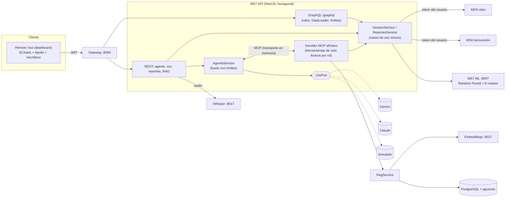

# MS7 - Inteligencia (ML, GraphQL, agente con MCP, RAG y voz)

MS7 ofrece analítica de **gestión** (no clínica) a administración, recepción y caja: resumen de citas, ingresos, demanda por especialidad,
riesgo de inasistencia, consulta de políticas (RAG) y un asistente en lenguaje natural (texto o voz) que puede generar reportes Excel/CSV/PDF.

> Es un proyecto académico. Las predicciones y respuestas del asistente son **apoyo a la gestión**: no sustituyen el criterio humano ni se usan
> para negar atención. El asistente nunca ve datos de pacientes ni información clínica.

## Piezas y puertos

| Pieza | Tecnología | Puerto | Quién la llama |
|---|---|---|---|
| MS7 API | NestJS (GraphQL + REST + MCP) | 3007 (vía gateway: `/graphql`, `/api/inteligencia/**`) | frontend (remoto Vue) |
| MS7 ML | FastAPI + scikit-learn | 8007 | solo MS7 API |
| MS7 embeddings | FastAPI + sentence-transformers | 8027 | solo MS7 API |
| MS7 whisper | FastAPI + faster-whisper | 8017 | solo MS7 API (nunca el navegador) |
| PostgreSQL `ms7_inteligencia` | pgvector (HNSW) | 5432 | MS7 API (RAG) |
| LLM en la nube | Gemini (por defecto) o Claude | — | MS7 API (`LLM_PROVIDER`) |

## Arquitectura



### Una consulta del agente

```mermaid
sequenceDiagram
  actor U as Usuario
  participant API as MS7 API
  participant A as AgenteService
  participant M as Servidor MCP (por petición y rol)
  participant L as LLM (Gemini/Claude)
  participant S as Casos de uso / MS3 / MS6 / RAG
  U->>API: POST /agente/consulta {texto} + JWT
  API->>A: consultar(texto, identidad)
  A->>A: límite por usuario (429) · lista blanca = herramientas del rol
  A->>M: listTools (solo las permitidas)
  loop hasta AGENTE_MAX_ITERACIONES / AGENTE_TIMEOUT_MS
    A->>L: mensajes + herramientas + prompt de sistema
    L-->>A: texto final o llamadas a herramientas
    A->>M: callTool(nombre, args)  [zod valida; fuera de lista → rechazada y auditada]
    M->>S: caso de uso con el token del usuario
    S-->>M: datos → redactar() → auditoría
    M-->>A: resultado
    A->>A: envolver como <datos_herramienta> (datos, no instrucciones)
  end
  A-->>API: respuesta (redactada) + herramientas usadas + reporte
  API-->>U: JSON
```

## Decisiones

- **Identidad:** el token del usuario se propaga a MS3 y MS6; cada servicio lo valida y aplica sus reglas por rol. MS7 no tiene privilegios propios ni cuenta de servicio.
- **MCP en memoria:** agente y herramientas viven en el mismo proceso; stdio exigiría un proceso hijo por consulta y HTTP un puerto extra que proteger. El servidor se crea **por petición** y solo
  registra las herramientas que el rol permite. Cambiando el transporte se podría publicar el mismo servidor a otros clientes MCP.
- **Una sola lógica:** GraphQL, las herramientas MCP y los reportes llaman a los mismos casos de uso (`GestionService`).
- **GraphQL solo en MS7:** `DataLoader` por petición evita el N+1 del campo `riesgo`; límites de profundidad (6) y complejidad (120 campos); argumentos validados; introspección desactivada con `NODE_ENV=production`.
- **Embeddings separados de Whisper:** latencias y perfiles de carga distintos (ver `docs/PENDIENTES.md`, L4).

## Herramientas del agente (todas de solo lectura, parámetros validados con zod)

| Herramienta | Roles | Devuelve |
|---|---|---|
| `obtener_resumen_citas` | administrador, recepción, caja | citas por especialidad/médico/estado/mes |
| `consultar_ingresos` | administrador, caja | ingresos por día/mes (MS6) |
| `consultar_demanda_especialidades` | gestión | segmentos K-means |
| `consultar_prediccion_inasistencia` | gestión | citas próximas con mayor riesgo |
| `consultar_politicas` | gestión | fragmentos del RAG con documento y sección |
| `generar_reporte` | gestión | extracto; el reporte completo viaja aparte en la respuesta |

### Seguridad

1. Lista blanca por rol: lo que no está registrado ni se ofrece al modelo ni se ejecuta (se rechaza y se audita).
2. Solo lectura; ninguna herramienta acepta SQL, código ni URLs. Los reportes son una **especificación JSON** (fuente, columnas, filtros, orden, gráfico) validada con zod; MS7 la ejecuta con datos reales.
3. Inyección de prompts: el prompt de sistema declara que lo devuelto por herramientas y documentos son **datos**; los resultados se envuelven en `<datos_herramienta>` y se neutralizan los delimitadores falsos.
4. Redacción: se eliminan claves de datos personales/clínicos de los resultados y se enmascaran correos, teléfonos y tokens en la respuesta final.
5. Límites: iteraciones, tiempo, llamadas por turno y consultas por hora por usuario; fallos del proveedor → 503.
6. Auditoría de cada llamada (`GET /api/inteligencia/agente/auditoria`, solo administrador).

## Reportes

`POST /api/inteligencia/reportes?formato=json|xlsx|csv|pdf` con la especificación. El Excel lleva hoja **Datos** (cabecera con formato, filtros, formatos numéricos) y hoja **Resumen**
(parámetros, filas, totales y avisos). CSV y Excel neutralizan fórmulas (`=`, `+`, `-`, `@`).

## RAG

Documentos de ejemplo (ficticios) en `docs/rag/`. Ingesta: `POST /api/inteligencia/rag/reindexar` (administrador) → fragmentos de ~480 caracteres con solapamiento de 80, cortados en oraciones,
con metadatos (documento, sección, versión) → embeddings (384 dim, `paraphrase-multilingual-MiniLM-L12-v2`) → tabla `rag_fragmentos` con índice HNSW (coseno). Solo se reindexa lo que cambia (hash).
`consultar_politicas` devuelve fragmentos con documento, sección y puntuación; por debajo de `RAG_SCORE_MINIMO` (0.3) no devuelve nada y el agente debe decir que no hay información suficiente.

### Preguntas de ejemplo y resultados esperados

Medido con pgvector y el modelo real (`test/rag.recuperacion.spec.ts`, `RAG_IT=1`): **primer resultado correcto 10/12, entre los 3 primeros 11/12**.

| Pregunta | Fragmento esperado | Resultado |
|---|---|---|
| ¿Cuánto tiempo antes puedo cancelar mi cita sin pagar nada? | Cancelación → *Cancelación por el paciente* | 1.º (0.82) |
| ¿Cuántas veces puedo reprogramar una cita sin costo? | Cancelación → *Reprogramación* | 1.º (0.71) |
| ¿Me devuelven el dinero si la clínica cancela mi cita? | Cancelación → *Cancelación por parte de la clínica* | 1.º (0.70) |
| ¿Cuánto cuesta una consulta de pediatría? | Aranceles → *Consultas* | 1.º (0.81) |
| ¿Hay descuento para los adultos mayores? | Aranceles → *Descuentos* | 1.º (0.78) |
| ¿Qué formas de pago aceptan? | Aranceles → *Formas de pago* | 1.º (0.65) |
| ¿A qué hora toman las muestras en el laboratorio? | Horarios → *Laboratorio e imagenología* | 1.º (0.77) |
| ¿Qué pasa si llego 20 minutos tarde a mi cita? | Protocolo → *Llegadas tardías* | 1.º (0.60) |
| ¿A quién se deriva a urgencias de inmediato? | Protocolo → *Triaje* | 1.º (0.52) |
| ¿Cuántos años guardan la historia clínica? | Protección de datos → *Conservación y seguridad* | 1.º (0.68) |
| ¿Quién puede ver mis datos de salud? | Protección de datos → *Quién puede acceder* | 2.º (0.41) |
| ¿Atienden los domingos? | Horarios → *Consulta externa* | **falla** (limitación conocida) |
| ¿Cuál es la capital de Francia? / receta de pastel / programar en Unity | *(sin información)* | sin resultados (≤ 0.10) |

## Voz

El remoto Vue elige la estrategia así: **Web Speech API** si hay conexión y el navegador la soporta (el texto aparece en la caja para que el usuario lo revise y pulse «Consultar»);
si no hay conexión o no existe (p. ej. Firefox), graba con `MediaRecorder` y sube el audio a `POST /api/inteligencia/agente/voz`, que lo transcribe con Whisper y consulta al agente.
La respuesta incluye la **transcripción** para que el usuario confirme que se entendió bien. Whisper limita tamaño (10 MB) y duración (60 s).

## Cómo ejecutarlo

```bash
cp .env.example .env                      # define GEMINI_API_KEY o ANTHROPIC_API_KEY, o usa LLM_PROVIDER=simulated
docker compose up -d && make dynamodb-init rabbitmq-declare
scripts/dev-services.sh start gateway ms3 ms6 ms7-ml ms7-embeddings ms7-whisper ms7
# modelos (ver services/ms7-inteligencia/ml/README.md): ml/no-show/train.py, ml/demanda/segmentar.py
scripts/e2e-ms7.sh                        # prueba de extremo a extremo con token real
```
