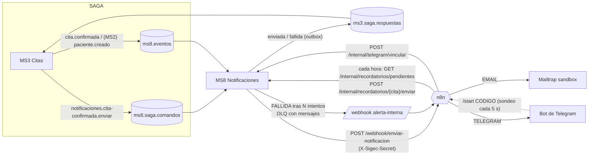

# Notificaciones (MS8 + n8n)

MS8 decide **a quién, qué y cuándo** notificar; n8n solo **transporta** el mensaje (correo por Mailtrap, mensajes por Telegram).
Un fallo de notificación **nunca anula una cita**.



## Flujo de una cita confirmada

1. MS3 confirma el cobro y envía `notificaciones.cita-confirmada.enviar` (y publica el evento `cita.confirmada`).
2. MS8 registra la notificación (`PENDIENTE`), resuelve los canales según las **preferencias** del paciente (por defecto EMAIL) y los datos de
   contacto (el email viene del evento `paciente.creado`; el chat de Telegram, de la vinculación), renderiza la plantilla y llama al webhook de n8n.
3. n8n entrega al proveedor. Si responde bien → `ENVIADA` y MS8 responde `...enviada` a MS3.
4. Si falla → queda `PENDIENTE` y se **reintenta con backoff exponencial** (`NOTIF_BACKOFF_BASE_MS` × 2^(intento-1); por defecto 30 s, 60 s, 2 min, 4 min).
   Con varios canales, un reintento solo repite el que falló. Tras `NOTIF_MAX_INTENTOS` (5) pasa a `FALLIDA`, MS8 responde `...fallida`
   (MS3 deja la cita `CONFIRMADA` con la notificación pendiente) y se dispara una **alerta interna**.
5. Un comando repetido (MS3 reenvía si no obtuvo respuesta) es idempotente por (cita, tipo).

Además de las alertas por `FALLIDA`, MS8 alerta cuando **una SAGA se compensa** (llega `cita-cancelada.enviar`) y cuando **crece una DLQ**
(monitor cada 60 s sobre todas las colas `*.dlq`; ver `make dlq-replay`).

## Plantillas (en `services/ms8-notificaciones/src/application/plantillas.ts`)

Tres plantillas en español — `cita-confirmada`, `recordatorio-cita` y `cita-cancelada` — con **contenido mínimo**: fecha y hora (hora de La Paz).
No incluyen especialidad, médico, diagnóstico ni el motivo interno de una cancelación. El texto de Telegram es aún más corto que el del correo.
MS8 envía a n8n el contenido ya renderizado (`datos.asunto/texto/html`), de modo que n8n no contiene lógica de negocio.

## Workflows de n8n (`infra/n8n/workflows/`)

| Workflow | Disparo | Qué hace |
|---|---|---|
| `enviar-notificacion` | webhook `POST /webhook/enviar-notificacion` | valida `X-Sigec-Secret`; `{canal, destinatario, plantilla, datos, notificacionId}`; EMAIL → API de Mailtrap, TELEGRAM → `sendMessage`; responde `200 {ok:true}`, `401`, `400` (canal) o `502 {ok:false,error}` |
| `recordatorio-cita` | cada hora + webhook `recordatorio-ejecutar` (manual) | pide a MS8 las citas de las próximas 24 h sin recordatorio y dispara el envío de cada una |
| `alerta-interna` | webhook `POST /webhook/alerta-interna` | mensaje al chat de administradores (`TELEGRAM_ALERT_CHAT_ID`) |
| `telegram-vinculacion` | cada 5 s | sondea el bot (`getUpdates`), procesa `/start <código>` y asocia el chat con el paciente; responde al usuario |

**Secretos:** los workflows no guardan ninguno; leen variables de entorno (`$env.X`) que el `docker-compose.yml` pasa desde `.env`
(`N8N_BLOCK_ENV_ACCESS_IN_NODE=false`). Dos secretos compartidos protegen los dos sentidos: `N8N_WEBHOOK_SECRET` (MS8 → n8n) y
`MS8_INTERNAL_SECRET` (n8n → `/internal/**` de MS8, que además no está expuesto por el gateway). Ambos se comparan en tiempo constante y, si
faltan, se rechaza todo.

### Importar / actualizar

```bash
docker compose up -d
make n8n-import     # importa los JSON, los publica (activa) y reinicia n8n
make n8n-export     # (tras editarlos en http://localhost:5678) vuelve a escribir los JSON del repo
```

Equivale a `n8n import:workflow --separate --input=/workflows` + `n8n publish:workflow --id=...` dentro del contenedor (los JSON están montados
en `/workflows`). También se pueden importar a mano desde la interfaz: *Workflows → Import from file*. n8n persiste su estado en la base
PostgreSQL `n8n` (volumen `pg_data`), así que sobrevive a `docker compose restart`.

## Configurar Mailtrap

1. Cuenta en <https://mailtrap.io> → **Email Testing → Inboxes** → crea (o usa) un inbox.
2. En el inbox → **API**: copia el *API token* y anota el **id del inbox**; el **id de la cuenta** está en la URL (`/accounts/<id>/...`).
3. En `.env`:

```
MAILTRAP_API_TOKEN=...
MAILTRAP_INBOX_ID=...
MAILTRAP_ACCOUNT_ID=...      # solo para la verificación automática
MAIL_FROM=no-reply@sigec.test
```
4. `docker compose up -d n8n` (recrea el contenedor con las variables nuevas). Los correos aparecen en la bandeja del inbox; no salen a Internet.

> No se pudo verificar contra la API real de Mailtrap en este entorno (sin credenciales). El workflow usa `POST {MAILTRAP_API_URL}/api/send/{inbox_id}`
> con `Authorization: Bearer <token>` y se probó contra un servidor simulado con ese mismo contrato. Revisa en tu cuenta que coincide.

## Configurar el bot de Telegram

1. En Telegram, habla con **@BotFather** → `/newbot` → copia el token a `TELEGRAM_BOT_TOKEN` y el nombre de usuario a `TELEGRAM_BOT_USERNAME`.
2. Alertas internas: crea un grupo de administradores, añade el bot, escribe un mensaje y consulta
   `https://api.telegram.org/bot<TOKEN>/getUpdates` para ver el `chat.id` (negativo en grupos) → `TELEGRAM_ALERT_CHAT_ID`.
3. `docker compose up -d n8n` y `scripts/test-telegram.sh` (envía un mensaje de prueba al chat de alertas con el token real).
4. El bot se consulta por **sondeo** (`getUpdates`), así que no necesita una URL pública. No uses a la vez un webhook de Telegram para el mismo bot.

### Vincular el Telegram de un paciente

```bash
# el paciente (o recepcion) genera un codigo de un solo uso, valido 10 minutos
curl -X POST http://localhost:8090/api/notificaciones/telegram/vinculo -H "Authorization: Bearer $TOKEN" \
     -H "Idempotency-Key: $(uuidgen)" -H 'Content-Type: application/json' -d '{"pacienteId":"<uuid>"}'
# -> {"codigo":"K7M2QX9A","expiraEn":"...","instruccion":"Abre el bot de SIGEC en Telegram y envia: /start K7M2QX9A"}
```
El paciente escribe `/start K7M2QX9A` al bot; en ≤5 s el workflow lo asocia con su `paciente_id` y el bot confirma. El código se consume de forma
atómica (un solo uso, también con intentos simultáneos) y caduca a los 10 minutos.

Preferencias de canal: `GET|PUT /api/notificaciones/preferencias/{pacienteId}` con `{"canales":["EMAIL","TELEGRAM"]}` (EMAIL, TELEGRAM o ambos).
Un paciente solo gestiona las suyas (claim `paciente_id`); `administrador` y `recepcion`, las de cualquiera.

## Variables de entorno

| Variable | Dónde | Por defecto |
|---|---|---|
| `NOTIF_SENDER` | MS8 | `n8n` (`simulated` = doble de pruebas, no envía nada) |
| `N8N_BASE_URL`, `N8N_WEBHOOK_SECRET`, `N8N_TIMEOUT_MS`, `N8N_REINTENTOS` | MS8 | `http://localhost:5678`, —, 8000, 1 |
| `MS8_INTERNAL_SECRET` | MS8 y n8n | — |
| `NOTIF_MAX_INTENTOS`, `NOTIF_BACKOFF_BASE_MS`, `NOTIF_SWEEP_MS`, `DLQ_MONITOR_MS` | MS8 | 5, 30000, 2000, 60000 |
| `MAILTRAP_*`, `MAIL_FROM`, `TELEGRAM_BOT_TOKEN`, `TELEGRAM_ALERT_CHAT_ID`, `TELEGRAM_API_URL`, `MS8_URL_FROM_N8N` | n8n (vía compose) | ver `.env.example` |

## Pruebas

```bash
pnpm --filter ms8-notificaciones test              # servicio (reintentos/backoff, FALLIDA, canales, vinculacion), adaptador n8n simulado, DynamoDB Local
make n8n-import && scripts/test-n8n-workflows.sh   # los 4 workflows en un n8n real contra Mailtrap/Telegram/MS8 simulados (25 comprobaciones)
scripts/e2e-notificaciones.sh                      # MS8 + n8n reales: paciente -> cita -> correo, Telegram, fallo/alerta (29) ; Mailtrap REAL solo con credenciales
scripts/test-telegram.sh [chat_id]                 # bot real con el token del .env
```

Sin credenciales, la parte de Mailtrap real de `e2e-notificaciones.sh` se **omite** (y lo dice); el resto se ejecuta contra proveedores simulados, lo que
valida los workflows y MS8 pero no la API real de Mailtrap/Telegram.
