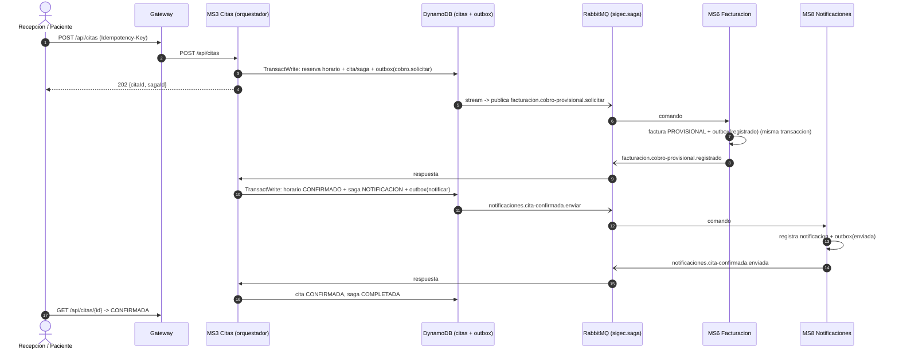
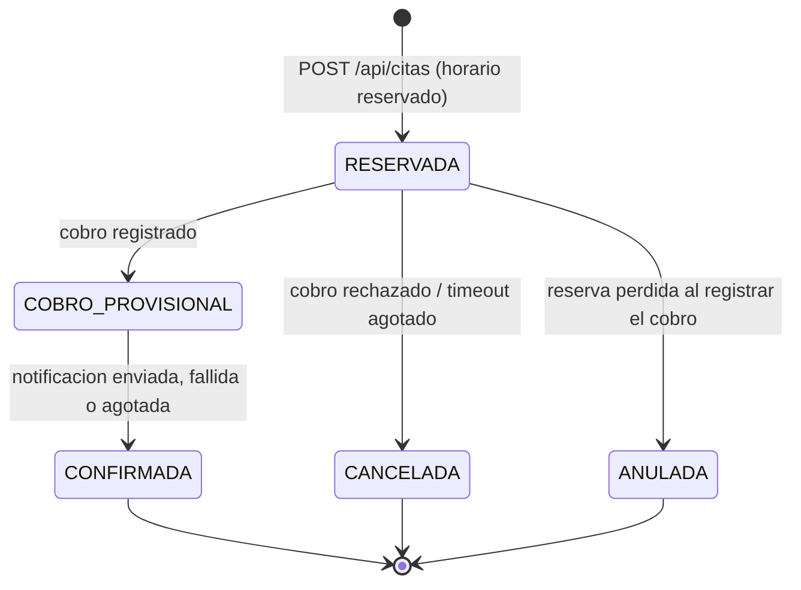

# SAGA de citas (orquestada por MS3)

`POST /api/citas` inicia una SAGA que coordina tres servicios: **MS3** reserva el horario y orquesta, **MS6** hace el cobro
provisional y **MS8** notifica. No hay transaccion distribuida: cada paso es una transaccion local y los fallos se
resuelven con **compensaciones**. El estado de la SAGA se persiste, asi que sobrevive a un reinicio de MS3.

## Flujo feliz



## Estados



| Estado de la cita | Significado |
|---|---|
| `PENDIENTE` | Solo conceptual: la reserva y la creacion son atomicas, por eso la cita nace `RESERVADA` |
| `RESERVADA` | Horario reservado, esperando el cobro provisional |
| `COBRO_PROVISIONAL` | Cobro registrado, horario confirmado, esperando la notificacion |
| `CONFIRMADA` | Terminada. Si la notificacion fallo, `notificacion = PENDIENTE` y se reintenta aparte |
| `CANCELADA` | Compensada sin cobro conocido (rechazo o timeout) |
| `ANULADA` | Compensada habiendo un cobro, que se anula |

La SAGA (`saga.estado`): `EN_CURSO` -> `COMPLETADA` | `COMPENSADA`. Pasos: `COBRO_PROVISIONAL`, `NOTIFICACION`, `FIN`.

## Compensaciones

Se ejecutan en **orden inverso** a los pasos hechos:

1. `ANULAR_COBRO`: `facturacion.cobro.anular` (solo si el cobro pudo existir). Se encola en el outbox y se confirma de forma
   asincrona (`saga.anulacionCobro`: `PENDIENTE` -> `CONFIRMADA`).
2. `LIBERAR_HORARIO`: el horario vuelve a `LIBRE` (no espera la anulacion del cobro).
3. `NOTIFICAR_CANCELACION`: `notificaciones.cita-cancelada.enviar` (sin respuesta).

| Causa | Cita | Compensaciones |
|---|---|---|
| Cobro **rechazado** (monto 0, paciente bloqueado, ...) | `CANCELADA` | `LIBERAR_HORARIO`, `NOTIFICAR_CANCELACION` (no hay cobro que anular) |
| **Timeout** del cobro tras 3 intentos (MS6 caido) | `CANCELADA` | `ANULAR_COBRO`, `LIBERAR_HORARIO`, `NOTIFICAR_CANCELACION` (el cobro puede existir) |
| **Reserva perdida** (expiro y otra cita tomo el horario) al registrar el cobro | `ANULADA` | `ANULAR_COBRO`, `LIBERAR_HORARIO`, `NOTIFICAR_CANCELACION` |
| Cobro registrado **tarde**, ya compensada la SAGA | `ANULADA` | `ANULAR_COBRO` otra vez |

Un **fallo de notificacion no anula la cita**: queda `CONFIRMADA` con `notificacion = PENDIENTE` y se reintenta aparte
(hasta 5 veces, cada 30 s). Si llega la confirmacion tardia pasa a `ENVIADA`.

Si MS6 recibe `cobro.anular` **antes** de la solicitud (los reintentos pueden reordenar mensajes) deja una *lapida*
(factura `ANULADA`) y la solicitud tardia se rechaza: nunca se cobra una cita anulada.

## Mensajes

Contrato completo en [`contracts/events/`](../contracts/events/README.md). Todos viajan por el exchange `sigec.saga` con
`correlationId = sagaId` y `causationId` = id del mensaje que los causo.

| Mensaje | De -> A | Cuando |
|---|---|---|
| `facturacion.cobro-provisional.solicitar` | MS3 -> MS6 | tras reservar; se reenvia en cada reintento |
| `facturacion.cobro-provisional.registrado` / `.rechazado` | MS6 -> MS3 | respuesta al cobro |
| `notificaciones.cita-confirmada.enviar` | MS3 -> MS8 | tras registrar el cobro |
| `notificaciones.cita-confirmada.enviada` / `.fallida` | MS8 -> MS3 | respuesta a la notificacion |
| `facturacion.cobro.anular` | MS3 -> MS6 | compensacion |
| `facturacion.cobro.anulado` | MS6 -> MS3 | confirmacion de la anulacion |
| `facturacion.cobro.confirmar` | MS3 -> MS6 | paso final **opcional** (`SAGA_CONFIRMAR_COBRO=true`); sin respuesta |
| `notificaciones.cita-cancelada.enviar` | MS3 -> MS8 | tras compensar; sin respuesta |

## Politica de tiempos

| Parametro | Por defecto | Variable de entorno (MS3) |
|---|---|---|
| Vigencia de la reserva del horario | 10 min | `SAGA_RESERVA_TTL_SEGUNDOS` (600) |
| Timeout por paso | 30 s | `SAGA_STEP_TIMEOUT_MS` (30000) |
| Intentos por paso (incluye el primero) | 3 | `SAGA_MAX_ATTEMPTS` |
| Backoff exponencial entre intentos | `2 s * 2^(n-1)` + jitter hasta 25 % | `SAGA_BACKOFF_BASE_MS` (2000), `SAGA_JITTER_RATIO` (0.25) |
| Reintentos de notificacion fuera de la SAGA | 5, cada 30 s | `SAGA_NOTIF_MAX_REINTENTOS`, `SAGA_NOTIF_REINTENTO_MS` |
| Paso final `cobro.confirmar` | desactivado | `SAGA_CONFIRMAR_COBRO` |
| Barrido de plazos | cada 1 s | `SAGA_SWEEP_MS` |

Con los valores por defecto, MS6 caido: reintento a los 30 s (+2 s), otro a los ~64 s (+4 s) y compensacion a los ~100 s.

La **expiracion de la reserva no depende del TTL de DynamoDB** (puede tardar hasta 48 h): un horario `RESERVADO` con
`reservaExpiraEn < ahora` equivale a `LIBRE` y se evalua al leer y en la condicion de la escritura.

## Modelo en DynamoDB (tabla `citas`, pk/sk)

| pk | sk | Contenido |
|---|---|---|
| `CITA#<citaId>` | `CITA` | agregado: datos de la cita, estado, `notificacion`, `saga` (paso, intentos, deadline, historial, compensaciones), `version` |
| `HORARIO#<medicoId>` | `<fechaHora ISO UTC>` | `estado` (`RESERVADO`/`CONFIRMADO`/`LIBRE`), `citaId`, `reservaExpiraEn` |

Indice disperso `gsi1` (`gsi1pk` / `gsi1sk`): `SAGA#ACTIVA` por plazo y `NOTIF#PENDIENTE` por proximo intento; el barrido consulta solo lo vencido.

Cada cambio es **una** `TransactWriteItems`: agregado (con condicion de version), operaciones del horario condicionales y los
mensajes del outbox (`outbox`). Asi no hay estado a medias ni mensajes perdidos.

| Operacion | Condicion |
|---|---|
| `RESERVAR` | el horario no existe, esta `LIBRE`, o esta `RESERVADO` con la reserva vencida |
| `CONFIRMAR` | `RESERVADO` y `citaId` = la nuestra (si no, `HORARIO_PERDIDO` -> compensacion) |
| `LIBERAR` | `citaId` = la nuestra (si ya es de otra cita se ignora) |

## Garantias de entrega

- **Outbox:** los comandos se escriben en la transaccion del cambio de estado y un stream/poller los publica (docs/outbox.md).
- **Al menos una vez + deduplicacion:** cada consumidor descarta por `id` del mensaje (`processed_messages`), y MS6 ademas es
  idempotente **por cita** (los reintentos de MS3 llevan ids nuevos).
- **Idempotencia HTTP:** `POST /api/citas` exige `Idempotency-Key` (docs/idempotencia.md).
- **Errores:** los consumidores reintentan con colas de espera (5 s, 30 s, 2 min) y pasan a la DLQ tras 3 reintentos.

## API

| | |
|---|---|
| `POST /api/citas` | roles `recepcion`, `paciente`, `administrador`. `202 {citaId, sagaId, estado, seguimiento}`; `409` horario ocupado; `400` datos o cabecera invalidos |
| `GET /api/citas/{id}` | estado, `notificacion`, `facturaId`, `motivoFallo`, `saga` (paso, intentos, compensaciones) y `pasos` (historial) |
| `GET /api/citas` | listado (ultimas 100) |
| `GET /api/notificaciones?citaId=` | notificaciones de MS8 de una cita |

Reglas de prueba de MS6/MS8 (solo desarrollo): el paciente `00000000-0000-4000-8000-00000000dead` siempre tiene el cobro
rechazado; con `NOTIF_FAIL_PACIENTES=<uuid>` MS8 falla al notificar a ese paciente; las tarifas estan en `config/facturacion.php`.

## Pruebas

```bash
pnpm --filter ms3-citas test                         # maquina de estados, servicio y repositorio (DynamoDB Local)
pnpm --filter ms8-notificaciones test
(cd services/ms6-facturacion && php artisan test)    # incluye SagaCommandHandlerTest
docker compose up -d && make dynamodb-init && make rabbitmq-declare
make e2e-saga                                        # scripts/e2e-saga.sh: escenarios (a)-(g) con token real (~4 min)
```


## Ciclo de vida de una cita confirmada (Fase 2)

Una vez `CONFIRMADA` la cita sale de la SAGA y se modifica con funciones puras en `application/saga/ciclo-vida.ts` (misma persistencia atomica: cita + horario + outbox en una transaccion).
Las citas con la SAGA **en curso** no se tocan (`409 CITA_EN_PROCESO`).

| Operacion | Efecto | Eventos / comandos |
|---|---|---|
| `POST /api/citas/{id}/cancelar` | estado `CANCELADA_USUARIO`; libera el horario; anula el cobro (`anulacionCobro` PENDIENTE → CONFIRMADA al responder MS6); deja de reintentar el aviso | `facturacion.cobro.anular`, `notificaciones.cita-cancelada.enviar`, evento `cita.cancelada` |
| `POST /api/citas/{id}/reprogramar` | `TOMAR` el horario nuevo ya CONFIRMADO + `LIBERAR` el viejo en **la misma** `TransactWriteItems`; si el nuevo esta ocupado nada cambia (`409 HORARIO_OCUPADO`); el cargo se conserva | evento `cita.reprogramada` |
| `POST /api/citas/{id}/asistencia` | `LLEGO` → `EN_SALA`; `ATENDIDA` → `ATENDIDA`; `NO_ASISTIO` (solo pasada la hora) → `NO_ASISTIO` | evento `cita.asistencia-registrada` (alimenta el modelo de inasistencia de MS7) |

**Horarios.** La plantilla semanal (`MEDICO#id/PLANTILLA`, horas locales de la clinica, `CLINICA_UTC_OFFSET_MIN`, por defecto -240) genera los horarios `LIBRE`; un bloqueo (`MEDICO#id/BLOQUEO#...`) los pasa a `BLOQUEADO` y devuelve las citas que ya estaban dentro (no se cancelan solas). Con `HORARIOS_ESTRICTOS=true` solo se pueden reservar horarios publicados; por defecto (false) una fecha sin item cuenta como libre, que es el comportamiento historico de la SAGA y de los E2E.

**Proyecciones.** MS3 consume `ms3.eventos` (`paciente.creado|actualizado`, `medico.creado|actualizado`) para mostrar nombres en la agenda sin llamar a MS2.
