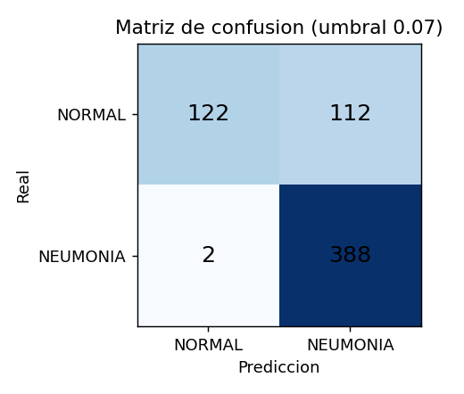
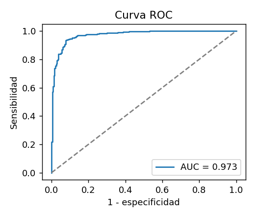

# Informe de entrenamiento - clasificador de neumonia

> Apoyo a la decision clinica; NO es un diagnostico. Proyecto academico, sin validacion clinica.

- Fecha: 2026-11-10T06:33:02+00:00
- Dataset: Kaggle paultimothymooney/chest-xray-pneumonia
- Imagenes: entrenamiento 4433 / validacion 783 / prueba 624
- Distribucion de clases (entrenamiento): {'NORMAL': 1140, 'PNEUMONIA': 3293}  ->  pesos de clase {'NORMAL': 1.944, 'PNEUMONIA': 0.673}
- Arquitectura: MobileNetV2 (transfer learning, pesos: imagenet), cabeza GAP + Dropout 0.3 + Dense sigmoide
- Entrenamiento: 8 epocas con la base congelada (lr 0.001) + 6 de ajuste fino de las ultimas 30 capas (lr 1e-05); lote 32; semilla 42
- Aumento de datos: rotacion 4 %, zoom 8 %, traslacion 5 %, contraste 15 % (sin volteo horizontal)
- Entorno: Python 3.13.16, TensorFlow 2.21.0, GPU

## Resultados

El umbral se elige con el indice de Youden sobre VALIDACION (no sobre prueba) y se aplica sin tocarlo al conjunto de PRUEBA.

| Conjunto | Umbral | AUC | Sensibilidad | Especificidad | Exactitud | n |
|---|---|---|---|---|---|---|
| Validacion | 0.067 | 0.9966 | 0.9914089347079038 | 0.9601990049751243 | 0.9834 | 783 |
| **Prueba** | 0.067 | 0.9727 | 0.9948717948717949 | 0.5213675213675214 | 0.8173 | 624 |

Matriz de confusion (prueba): VN=122 FP=112 FN=2 VP=388

 

## Limitaciones (leer antes de usar)

- Dataset pediatrico de un solo centro (Guangzhou); no generaliza a otras poblaciones, equipos ni adultos.
- El conjunto de prueba publico (624 imagenes) es pequeno; los intervalos de confianza son amplios.
- La validacion publica de Kaggle tiene solo 16 imagenes, por eso aqui la validacion se separa del entrenamiento (15 % estratificado).
- Un falso negativo (neumonia no detectada) es el error mas grave: la sensibilidad debe pesar mas que la exactitud.
- Es apoyo a la decision. Nunca sustituye la lectura del radiologo ni el criterio clinico.
