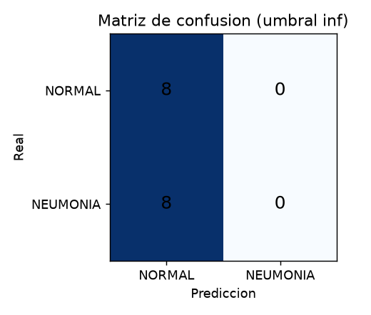
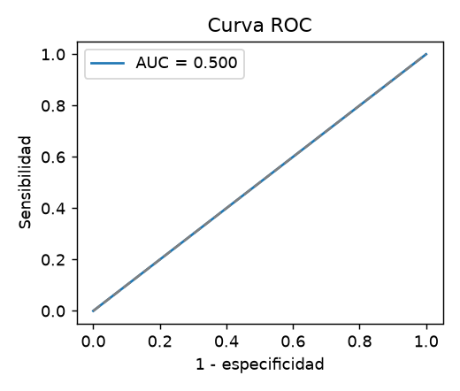

# Informe de entrenamiento - clasificador de neumonia

> **PRUEBA DE HUMO SINTETICA.** Se entreno con imagenes aleatorias generadas SOLO para comprobar que el codigo funciona. No son radiografias y las metricas no significan nada.

> Apoyo a la decision clinica; NO es un diagnostico. Proyecto academico, sin validacion clinica.

- Fecha: 2026-11-01T22:41:29+00:00
- Dataset: SINTETICO (ruido aleatorio, no son radiografias)
- Imagenes: entrenamiento 40 / validacion 8 / prueba 16
- Distribucion de clases (entrenamiento): {'NORMAL': 20, 'PNEUMONIA': 20}  ->  pesos de clase {'NORMAL': 1.0, 'PNEUMONIA': 1.0}
- Arquitectura: MobileNetV2 (transfer learning, pesos: none), cabeza GAP + Dropout 0.3 + Dense sigmoide
- Entrenamiento: 2 epocas con la base congelada (lr 0.001) + 1 de ajuste fino de las ultimas 30 capas (lr 1e-05); lote 8; semilla 42
- Aumento de datos: rotacion 4 %, zoom 8 %, traslacion 5 %, contraste 15 % (sin volteo horizontal)
- Entorno: Python 3.11.18, TensorFlow 2.21.0, CPU

## Resultados

El umbral se elige con el indice de Youden sobre VALIDACION (no sobre prueba) y se aplica sin tocarlo al conjunto de PRUEBA.

| Conjunto | Umbral | AUC | Sensibilidad | Especificidad | Exactitud | n |
|---|---|---|---|---|---|---|
| Validacion | inf | 0.5 | 0.0 | 1.0 | 0.5000 | 8 |
| **Prueba** | inf | 0.5 | 0.0 | 1.0 | 0.5000 | 16 |

Matriz de confusion (prueba): VN=8 FP=0 FN=8 VP=0

 

## Limitaciones (leer antes de usar)

- Dataset pediatrico de un solo centro (Guangzhou); no generaliza a otras poblaciones, equipos ni adultos.
- El conjunto de prueba publico (624 imagenes) es pequeno; los intervalos de confianza son amplios.
- La validacion publica de Kaggle tiene solo 16 imagenes, por eso aqui la validacion se separa del entrenamiento (15 % estratificado).
- Un falso negativo (neumonia no detectada) es el error mas grave: la sensibilidad debe pesar mas que la exactitud.
- Es apoyo a la decision. Nunca sustituye la lectura del radiologo ni el criterio clinico.
